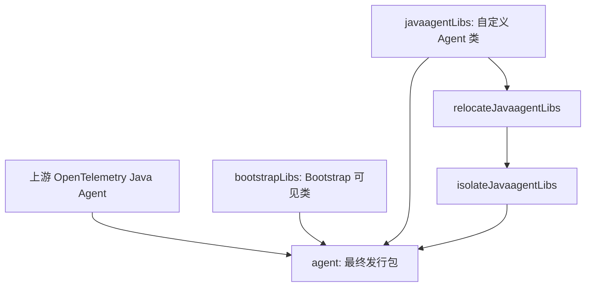

# Datafox Java Agent 架构

状态：按 Splunk v2.32.0 对齐工程基础设施；新一轮 build / test / smoke-test CI 正在执行
更新日期：2026-10-25

## System Purpose

Datafox Java Agent 是基于 OpenTelemetry Java Instrumentation 的定制发行版。优先复用官方 Agent、SDK、Instrumentation、SPI 和生命周期，不 Fork 上游核心。

## Code Map

**当前仓库事实：** 已建立 Gradle 9.8.1 Wrapper、`:agent`、`:bootstrap`、`:custom`、`:dependencyManagement`、`:instrumentation`、`:smoke-tests`、`:testing:common` 和 `:testing:agent-for-testing`；`buildSrc` 提供 Java、Spotless、Shadow 与可选 Muzzle 约定。Agent 包含 Splunk 风格的三阶段 Shadow 打包、无 classifier Maven 主制品、Sources/Javadoc 和可选 GPG 签名。当前 CI 正在验证这些新增模块。

**对齐策略：** 工程基础设施、Gradle 约定、Shadow 任务、测试与评测流水线优先 1:1 对齐 [Splunk Java Agent v2.32.0](https://github.com/signalfx/splunk-otel-java/tree/v2.32.0)。Splunk 的 Realm/Token、OpAMP、Profiler、No-code 与专有应用服务器 Instrumentation 等产品功能不复制。

详细设计见 [基于 Splunk 的 Gradle 发行版工程设计草案](docs/design-docs/datafox-gradle-distribution.md)。

## Dependency Direction

构建遵循 Splunk 的 `upstreamAgent` / `bootstrapLibs` / `javaagentLibs` 三种 Configuration，以及 relocation → `inst/*.classdata` 隔离 → `shadowJar` 的三阶段打包。

## Architectural Invariants

- 不采用独立或嵌入式 Extension JAR 作为发行版架构；发行版内部仍可使用官方 SPI。
- 不重新实现 OpenTelemetry Agent 的 `premain`、SDK、Exporter 或 Context。
- 新增类必须遵守 Bootstrap、Agent 和 Application ClassLoader 边界。
- 用户显式 `otel.*` 配置优先于发行版默认值；专有配置使用 `datafox.*`。
- 对齐 Splunk 的构建、测试、Muzzle、Smoke Test、许可证报告与发布机制；不复制 Splunk 产品专有功能。
- 新增复杂度必须有当前业务需求依据；正式实施时再验证构建和运行行为。

## System Boundaries

运行时 Agent 由目标 JVM 通过 `-javaagent` 加载；应用业务代码和上游 Instrumentation 属于受监控应用边界。导出协议、服务端依赖和发行渠道尚未确定。

## Cross-cutting Concerns

版本：当前 Datafox 开发版本 `0.1.0-SNAPSHOT`，上游 Agent 与 Instrumentation `2.32.0`，SDK `1.66.0`，Gradle `9.8.1`，Shadow `9.6.1`；发行版版本和上游版本分别维护。

文档：优先使用中文；技术 API、Gradle Task、RepoFoundryAI 机器识别字段保持原名。

## Known Gaps

- 首轮只验证了 JAR 打包与内容；新增的 MockWebServer + 子 JVM Smoke Test 尚待最新 CI 结果确认。
- 尚未添加 Datafox 专有 Instrumentation，因此 Muzzle 约定存在但当前没有目标模块。
- 最新依赖测试矩阵、跨操作系统应用服务器矩阵和正式发布渠道仍需按 Datafox 支持范围配置。

## Sources

- [R-001：OpenTelemetry 官方 Distro 研究](docs/research/active/r-001_opentelemetry-javaagent-upstream/SYNTHESIS.md)
- [R-002：Splunk 发行版工程研究](docs/research/active/r-002_splunk-java-agent-architecture/SYNTHESIS.md)
- [Datafox Gradle 工程设计草案](docs/design-docs/datafox-gradle-distribution.md)

此处记录已明确的工程方向；具体模块布局尚未形成正式 ADR。
