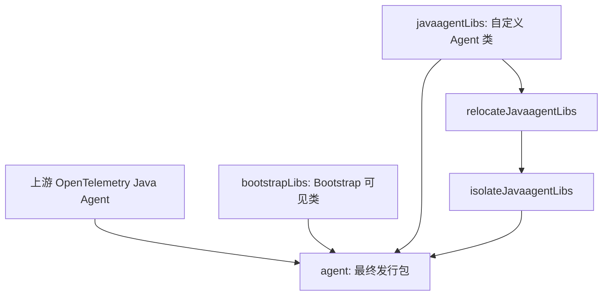

# Datafox Java Agent 架构

状态：最小 Gradle 发行版工程已建立；尚未进行应用级 Smoke Test
更新日期：2026-10-25

## System Purpose

Datafox Java Agent 是基于 OpenTelemetry Java Instrumentation 的定制发行版。优先复用官方 Agent、SDK、Instrumentation、SPI 和生命周期，不 Fork 上游核心。

## Code Map

**当前仓库事实：** 已建立 `settings.gradle.kts`、Gradle 9.8.1 Wrapper、`:agent`、`:custom`、`:dependencyManagement` 和 `buildSrc`。`:custom` 通过 `ResourceProvider` 提供 `telemetry.distro.name` 与 `telemetry.distro.version`；`:agent` 实现 Splunk 风格的三阶段 Shadow 打包。已在 GitHub Actions 中成功生成发行版 JAR 并检查内部类、SPI 和 Manifest 资源。

**模块取舍：** 工程组织和 Gradle 打包优先参考 [Splunk Java Agent v2.32.0](https://github.com/signalfx/splunk-otel-java/tree/v2.32.0)。以 `:agent` 为发行包构建入口，当前包含 `:custom` 和 `:dependencyManagement`。没有真正的 Bootstrap Helper、额外 Instrumentation 时，不创建空模块；后续功能需要时再添加。

详细设计见 [基于 Splunk 的 Gradle 发行版工程设计草案](docs/design-docs/datafox-gradle-distribution.md)。

## Dependency Direction

构建遵循 Splunk 的 `upstreamAgent` / `bootstrapLibs` / `javaagentLibs` 三种 Configuration，以及 relocation → `inst/*.classdata` 隔离 → `shadowJar` 的三阶段打包。

## Architectural Invariants

- 不采用独立或嵌入式 Extension JAR 作为发行版架构；发行版内部仍可使用官方 SPI。
- 不重新实现 OpenTelemetry Agent 的 `premain`、SDK、Exporter 或 Context。
- 新增类必须遵守 Bootstrap、Agent 和 Application ClassLoader 边界。
- 用户显式 `otel.*` 配置优先于发行版默认值；专有配置使用 `datafox.*`。
- 不提前复制 Splunk 的 OpAMP、Profiler、No-code 或专有应用服务器 Instrumentation。
- 新增复杂度必须有当前业务需求依据；正式实施时再验证构建和运行行为。

## System Boundaries

运行时 Agent 由目标 JVM 通过 `-javaagent` 加载；应用业务代码和上游 Instrumentation 属于受监控应用边界。导出协议、服务端依赖和发行渠道尚未确定。

## Cross-cutting Concerns

版本：当前 Datafox 开发版本 `0.1.0-SNAPSHOT`，上游 Agent 与 Instrumentation `2.32.0`，SDK `1.66.0`，Gradle `9.8.1`，Shadow `9.6.1`；发行版版本和上游版本分别维护。

文档：优先使用中文；技术 API、Gradle Task、RepoFoundryAI 机器识别字段保持原名。

## Known Gaps

- 已构建 Agent JAR，但尚未运行目标 JVM 应用或检查实际 OTLP 遥测行为；只完成 Gradle 打包与 JAR 内容检查。
- 首批 Datafox 自定义能力、最低 JVM 和发布渠道尚未确定。
- 按要求跳过独立 Research 原型；正式实施期间已执行构建与 JAR 检查，未执行应用级运行或性能测试。

## Sources

- [R-001：OpenTelemetry 官方 Distro 研究](docs/research/active/r-001_opentelemetry-javaagent-upstream/SYNTHESIS.md)
- [R-002：Splunk 发行版工程研究](docs/research/active/r-002_splunk-java-agent-architecture/SYNTHESIS.md)
- [Datafox Gradle 工程设计草案](docs/design-docs/datafox-gradle-distribution.md)

此处记录已明确的工程方向；具体模块布局尚未形成正式 ADR。
