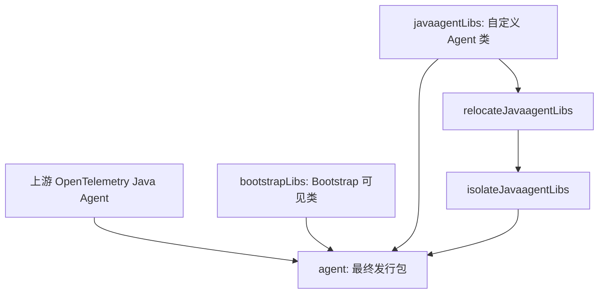

# Datafox Java Agent 架构

状态：工程设计阶段（尚未创建 Gradle 项目或 Agent 代码）
更新日期：2026-10-23

## System Purpose

Datafox Java Agent 是基于 OpenTelemetry Java Instrumentation 的定制发行版。优先复用官方 Agent、SDK、Instrumentation、SPI 和生命周期，不 Fork 上游核心。

## Code Map

**当前仓库事实：** 已安装 RepoFoundryAI Harness，维护研究文档和 GitHub Actions；尚无 `settings.gradle.kts`、Gradle Wrapper、Java 源码或可运行 Agent。

**目标结构（尚未实施）：** 工程组织和 Gradle 打包优先参考 [Splunk Java Agent v2.32.0](https://github.com/signalfx/splunk-otel-java/tree/v2.32.0)。以 `:agent` 为发行包构建入口；按真实功能增加 `:custom`、`:bootstrap`、`:instrumentation:*`、`:dependencyManagement` 和测试模块。

详细设计见 [基于 Splunk 的 Gradle 发行版工程设计草案](docs/design-docs/datafox-gradle-distribution.md)。

## Dependency Direction

构建遵循 Splunk 的 `upstreamAgent` / `bootstrapLibs` / `javaagentLibs` 三种 Configuration，以及 relocation → `inst/*.classdata` 隔离 → `shadowJar` 的三阶段打包。

## Architectural Invariants

- 不采用独立或嵌入式 Extension JAR 作为发行版架构；发行版内部仍可使用官方 SPI。
- 不重新实现 OpenTelemetry Agent 的 `premain`、SDK、Exporter 或 Context。
- 新增类必须遵守 Bootstrap、Agent 和 Application ClassLoader 边界。
- 用户显式 `otel.*` 配置优先于发行版默认值；专有配置使用 `datafox.*`。
- 不提前复制 Splunk 的 OpAMP、Profiler、No-code 或专有应用服务器 Instrumentation。
- 新增复杂度必须有当前业务需求依据；正式实施时再验证构建和运行行为。

## System Boundaries

运行时 Agent 由目标 JVM 通过 `-javaagent` 加载；应用业务代码和上游 Instrumentation 属于受监控应用边界。导出协议、服务端依赖和发行渠道尚未确定。

## Cross-cutting Concerns

版本：发行版版本与 OpenTelemetry 上游版本分别记录。源码研究基线为 Splunk `v2.32.0` 和 OpenTelemetry Instrumentation `v2.32.0`，尚未形成 Datafox 的构建版本锁定。

文档：优先使用中文；技术 API、Gradle Task、RepoFoundryAI 机器识别字段保持原名。

## Known Gaps

- 未建立 Gradle 工程及实际 Java Agent JAR。
- 首批 Datafox 自定义能力、最低 JVM 和发布渠道尚未确定。
- 按要求跳过独立 Research 原型；未执行构建、运行或性能测试。

## Sources

- [R-001：OpenTelemetry 官方 Distro 研究](docs/research/active/r-001_opentelemetry-javaagent-upstream/SYNTHESIS.md)
- [R-002：Splunk 发行版工程研究](docs/research/active/r-002_splunk-java-agent-architecture/SYNTHESIS.md)
- [Datafox Gradle 工程设计草案](docs/design-docs/datafox-gradle-distribution.md)

此处记录已明确的工程方向；具体模块布局尚未形成正式 ADR。
