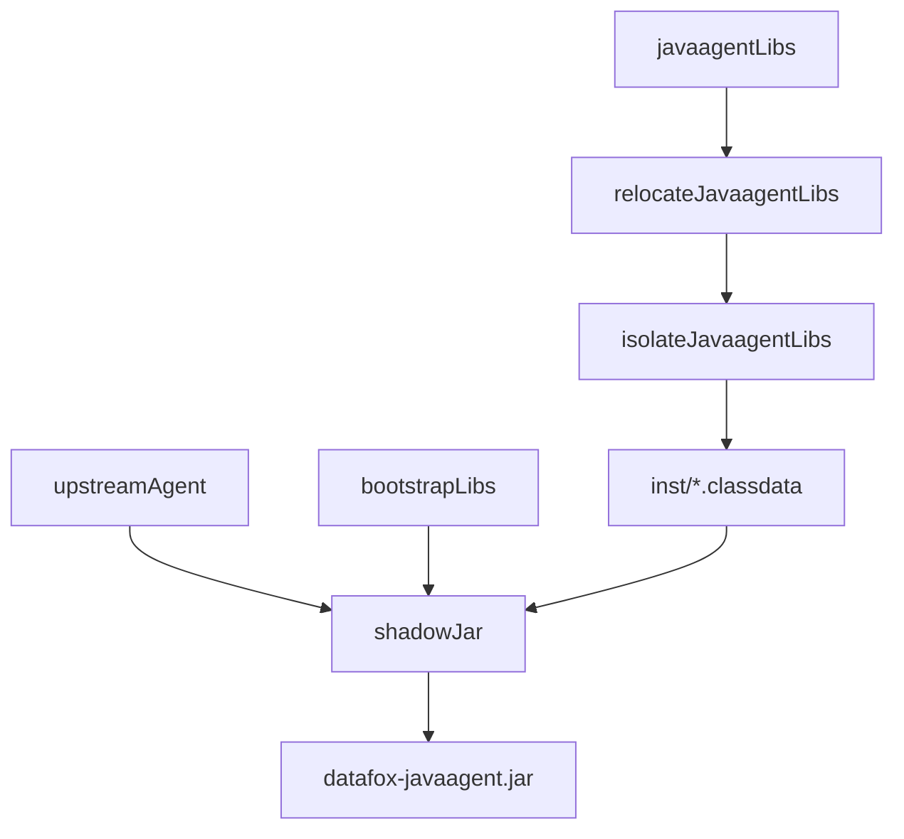

# Datafox Java Agent：基于 Splunk 的 Gradle 发行版工程设计（草案）

状态：最小工程骨架已实施，后续能力仍属设计草案；2026-10-25。**工程结构与 Gradle 打包优先参考 Splunk v2.32.0；运行时接口与类加载契约以 OpenTelemetry Java Instrumentation v2.32.0 为准。**

依据：
- [R-002：Splunk 发行版架构研究](../research/active/r-002_splunk-java-agent-architecture/SYNTHESIS.md)
- [R-002：Splunk Gradle 与打包源码分析](../research/active/r-002_splunk-java-agent-architecture/notes/gradle-and-packaging.md)
- [R-001：OpenTelemetry 官方 Distro 研究](../research/active/r-001_opentelemetry-javaagent-upstream/SYNTHESIS.md)
- [Splunk agent/build.gradle.kts](https://github.com/signalfx/splunk-otel-java/blob/v2.32.0/agent/build.gradle.kts)
- [Splunk shadow conventions](https://github.com/signalfx/splunk-otel-java/blob/v2.32.0/buildSrc/src/main/kotlin/splunk.shadow-conventions.gradle.kts)

## 1. 设计优先级

1. **工程组织和 Gradle 打包：Splunk First。** 参考 Splunk 的 `:agent`、`:bootstrap`、`:custom`、`:dependencyManagement`、`:instrumentation` 组织方式、Shadow 三阶段任务和版本管理。
2. **技术契约：OpenTelemetry Upstream First。** ClassLoader、`inst/*.classdata`、SPI、Instrumentation、Context 和 SDK 生命周期以官方当前兼容版本为准。
3. **模块落地：Datafox 需求优先。** 仅创建当前功能与打包实际需要的模块；不提前引入 Splunk Profiler、OpAMP、No-code、商业应用服务器 Instrumentation 或其发布渠道。
4. **明确排除：独立/嵌入式 Extension JAR 发行路线与 Fork 上游 Agent。** 允许发行版内部使用官方 SPI，但定制类直接作为 `javaagentLibs` 经隔离打入 Agent。

## 2. 工程布局（当前实现与后续规划）

```text
datafox-java-agent/
├── settings.gradle.kts
├── build.gradle.kts
├── version.gradle.kts                  # Datafox 发行版版本
├── gradle/
│   └── wrapper/
├── buildSrc/                           # 已实现 Shadow 公共规则
│   └── src/main/kotlin/
│       └── datafox.shadow-conventions.gradle.kts
├── dependencyManagement/               # 已实现 SDK/Agent 版本约束
│   └── build.gradle.kts
├── agent/
│   └── build.gradle.kts                 # 发行包与 Shadow 三阶段
├── custom/                              # 已实现发行版 ResourceProvider
│   └── build.gradle.kts
├── bootstrap/                           # 规划：仅有 Bootstrap 可见类时创建
│   └── build.gradle.kts
├── instrumentation/                     # 规划：仅新增专有埋点时创建
│   └── <feature>/build.gradle.kts
├── smoke-tests/                         # 规划：应用级 Smoke Test
└── .github/workflows/
```

当前已存在的项目为 `:agent`、`:custom`、`:dependencyManagement`；`buildSrc` 提供 Shadow 约定。上图的 `:bootstrap`、`:instrumentation`、`:smoke-tests` 是后续规划，**目前并不存在**。保留 `bootstrapLibs` Configuration 并不要求同时存在空的 `:bootstrap` 项目。

## 3. 依赖与类加载边界

参考 Splunk `:agent` 中的三个可解析 Gradle Configuration：

| Configuration | 目的 | 打包路径 |
|---|---|---|
| `upstreamAgent` | Maven 发布的 `io.opentelemetry.javaagent:opentelemetry-javaagent` | 保留上游 JAR 结构 |
| `bootstrapLibs` | 发行版新增 Bootstrap 可见类 | 最终 `shadowJar` 的 Bootstrap 部分 |
| `javaagentLibs` | Datafox SDK 定制与 Instrumentation 等新增类 | relocate → isolate → `inst/*.classdata` |

`:custom` 等模块引用由上游提供的 SDK/API/SPI 时优先 `compileOnly`；发行版特有的运行时库再用 `implementation`，由 Agent 打包任务处理。避免把上游已打包的 API 和 SDK 重复加入 AgentClassLoader。

## 4. Gradle Shadow 打包（必须对照 Splunk 实现）



1. `relocateJavaagentLibs`：复用 Splunk/上游的 relocation 规则与 `META-INF/services` 合并策略；排除 Bootstrap 已提供的 API 等重复依赖。对新增依赖逐项判断重定位规则。
2. `isolateJavaagentLibs`：将新增 Agent 库放入 `inst/`，转换 `.class` 为 `.classdata`，过滤签名和重复资源。
3. `shadowJar`：合并 `bootstrapLibs`、`upstreamAgent` 和隔离结果，合并 `inst/META-INF/services`，保留合法 Agent Manifest 和原有入口。

**入口取舍**：Splunk 的 `SplunkAgent.premain` 只是委托给 `OpenTelemetryAgent.agentmain`。Datafox 默认保留上游 `OpenTelemetryAgent` 的 `Premain-Class` / `Agent-Class`；只有明确需要启动前逻辑时才增加 Datafox 专有入口，避免纯品牌包装。

**Instrumentation 取舍**：若未来出现多个独立埋点模块，可参考 Splunk 按约定插件自动加入 `javaagentLibs` 的机制；模块少时直接显式声明。

## 5. 版本、发布和配置

- 基线：Splunk Distro `2.32.0`、上游 Instrumentation `2.32.0`、SDK `1.66.0`；Splunk 使用 Gradle `9.8.1`、Shadow `9.6.1`。这些版本已写入首批 Datafox Gradle 构建，发行版本暂定 `0.1.0-SNAPSHOT`。
- 发行版版本与上游版本分开定义；升级时同时核对 SDK/Instrumentation/Alpha 插件及 relocation。
- 优先复用标准 `otel.*` 配置；Datafox 专有项使用 `datafox.*`。不默认复制 Splunk Realm、Token、Sampler 或 SpanLimits 的产品策略。
- 发行物首先是可直接用 `-javaagent` 启动的单 JAR；Maven Central、签名、Docker/Operator 镜像等发布渠道待明确需求后增加。
- 参考 Splunk 的 Java 格式、依赖收敛、许可证与发布元数据，但不为未确定的功能增加 CI Matrix。

## 6. 当前范围和待定项

- **工程骨架已创建，但这仍不是已批准的 ADR，也不代表产品功能已完成。**
- 已提交 Gradle Wrapper、三模块项目、Shadow 约定插件和最小 ResourceProvider。
- [GitHub Actions 首次打包](https://github.com/datafoxlabs/datafox-java-agent/actions/runs/40158405101)已通过 `:agent:shadowJar`、SPI、`inst/*.classdata`、版本资源及 Manifest 检查。
- 按用户要求跳过独立 Research 原型；正式实施阶段目前仅完成构建与 JAR 内容检查，未运行应用级 Smoke Test。
- 待明确：Datafox 第一批自定义能力、是否有 Bootstrap 可见类、是否新增 Instrumentation、最低 JVM、交付渠道。它们决定最终模块数量和构建任务。

## 7. 工程设计原则

**Splunk 的工程结构与 Gradle 打包方式优先；OpenTelemetry 官方保证运行时契约；Datafox 只保留当前需要的代码。**
