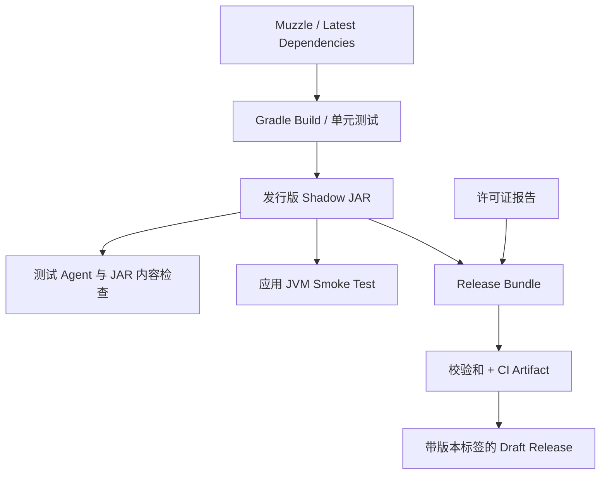
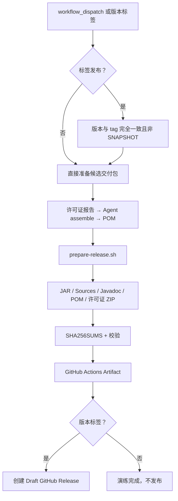

# Datafox Java Agent：评测与发行流程

> 工程对齐基线：[Splunk Java Agent v2.32.0](https://github.com/signalfx/splunk-otel-java/tree/v2.32.0)。本文解释已提交的 CI 和 Release 实现、它们各自验证什么，以及目前尚未覆盖的场景。产品专有功能不在本轮范围。

## 先看整体：为什么构建成功还不够？

Splunk 将 Java Agent 的工程保障拆成几层：编译、Instrumentation 依赖兼容性、实际应用运行、许可证与发布。Datafox 采用同样的职责分离。

其中，**构建 JDK**与**目标应用 JDK**是独立维度。构建与测试编排使用 Java 25，Smoke Test 另行下载目标 JDK，通过环境变量传给 Gradle，最终由 Java 的 `ProcessBuilder` 在子进程中以该 JDK 执行带 `-javaagent` 的应用。

## 1. CI：每一类任务检查什么？

主工作流：[agent-build.yml](../../.github/workflows/agent-build.yml)。

| 任务 | 验证内容 | 不能证明什么 |
|---|---|---|
| `build-and-unit-test` | `./gradlew build`、Spotless、单元测试、测试 Agent、JAR 文件布局和 Manifest | 不能仅凭它说明应用中产生了 Span |
| `test-latest-dependencies` | 专有 Instrumentation 存在时运行 `-PtestLatestDeps=true` | 没有目标 Instrumentation 时只是确认正确跳过 |
| `smoke-test` | 目标 JVM 真实装载最终发行版，检查 OTLP HTTP 数据 | 不等于所有框架或 JVM 组合都已覆盖 |
| `license-report` | 许可证清单、Release Bundle 构建、SHA-256 校验 | 不等于制品已实际对外发布 |

### 应用 JVM 测试矩阵

当前已配置 Linux 与 Windows 的 Java 8、11、17、21、25 测试组合。Gradle 本身始终由 Java 25 运行。轻量应用的源码单独编译为 Java 8 字节码，测试运行器使用 Java 17 字节码；由 Gradle 选择对应版本的子 JVM 执行真实 Agent，并向本地模拟 OTLP HTTP 接收端导出数据。

测试不仅看是否存在 HTTP 请求，还解析 OTLP Protobuf，检查应用 Span 名称和 `telemetry.distro.name` / `telemetry.distro.version`。**已通过 [2026-10-25 GitHub Actions](https://github.com/datafoxlabs/datafox-java-agent/actions/runs/40166248476) 的 10/10 个测试组合。**

Java 8/11 的独立编译目标及 Linux/Windows 运行组合均已通过 CI；这里验证的是简单应用加载 Agent 并导出 OTLP，不能据此推导所有 Java 8/11 应用框架都已得到验证。

### Muzzle 和最新依赖测试

`datafox.instrumentation-testing-conventions` 参考 Splunk 的 `library`、`testLibrary`、`latestDepTestLibrary` 依赖分组和预发布版本过滤。Muzzle 插件可以按 Instrumentation 模块启用；CI 发现已配置模块后运行相关任务。

当前没有 Datafox 自有 Instrumentation 子模块，所以 Latest Dependencies / Muzzle 的实际兼容性范围仍为空。工具链存在与版本兼容性得到实测是两回事。

为验证测试约定本身，工程新增 `:testing:instrumentation-harness`（不纳入生产 Agent 的 `javaagentLibs`），应用 `datafox.instrumentation-conventions`。其测试检查实际 JVM 启动参数中存在 `-javaagent:`，并确认已向测试 JVM传入 Instrumentation 初始化 JAR 路径。测试任务依赖 `:testing:agent-for-testing:shadowJar` 与本模块的 Shadow JAR。**这验证的是工程测试链路，不代表 Datafox 已经拥有产品级 Instrumentation 或有效的 Muzzle 兼容性矩阵。**

## 2. Release：普通 CI 与发布标签的区别

发布工作流：[release.yml](../../.github/workflows/release.yml)。

它支持两种入口：

1. **手动 `workflow_dispatch`**：打包和上传 `datafox-release-bundle`，不会创建 GitHub Release。这是安全的交付演练入口。
2. **推送 `vX.Y.Z` 形式的标签**：先验证标签与 `version.gradle.kts` 的 `distroVersion` 一致且不是 `-SNAPSHOT`，并检查 GPG 变量存在；随后生成、校验带分离式签名的发行制品，只创建 **Draft GitHub Release**，不直接公开发布。
3. **手动在正式版本标签上勾选 `publish_maven=true`**：在上述签名和版本检查通过的基础上，还必须配置 Sonatype 凭据，才会执行 Splunk 风格的 `publishToSonatype` / `closeAndReleaseSonatypeStagingRepository`。普通手动触发不会上传 Maven Central，分支触发勾选此项会直接失败。

### 交付包包含什么？

共享脚本：[scripts/prepare-release.sh](../../scripts/prepare-release.sh) 将下列产物放入 `dist/`：

- 可直接使用 `-javaagent` 的 `datafox-javaagent-*-all.jar`；
- Sources、Javadoc JAR；
- Maven Publication 生成的 POM；
- 许可证报告归档 `licenses.zip`；
- 全部文件对应的 `SHA256SUMS`，生成后立即进行校验。

常规 CI 与正式 Release **复用同一个打包脚本**；普通 CI 已通过生成和复核校验和。版本标签触发的 GitHub Release 草稿尚未实际执行。

### GPG 签名和 CI 验证如何区分？

真正带标签的 Release 需要仓库 Secrets：`GPG_SECRET_KEY`（ASCII-armored 私钥）、`GPG_PASSWORD`（密钥口令）、`GPG_KEY_ID`（签名密钥 ID）；手动启用 Maven 上传时还需要 `SONATYPE_USER`、`SONATYPE_KEY`。

- `scripts/sign-release.sh` 会在独立临时 GnuPG 目录中导入密钥，对 JAR、POM、许可证 ZIP 分别生成 `.asc` 分离式签名，再重新计算 `SHA256SUMS` 并对校验文件本身签名；执行后立即进行 GPG 验签，临时密钥目录自动清理。
- **普通 CI 只生成临时测试密钥，调用相同的签名脚本核对签名有效性，绝不会把临时测试密钥签出的 `.asc` 上传为正式发布产物。** 正式签名仅发生在受控的标签 Release 中。
- GitHub Draft Release 已存在时，只允许更新草稿；如果同名 Release 已经公开，则拒绝覆盖。

### Maven Central 与签名的现状

根项目已配置与 Splunk 相似的 Nexus Publishing 插件及 Sonatype 地址，Agent 具备 Maven Publication / 条件化 GPG 签名设置。常规 CI 使用 `:agent:publishToMavenLocal` 验证 POM、无 classifier 主 JAR、Sources/Javadoc 的本地发布路径；不会进行远程发布。带标签的自动流程仅准备已签名的草稿 Release，只有 `workflow_dispatch` 且明确启用 `publish_maven` 才执行真实 Sonatype 发布。

**Maven Central 远程上传仍未实际执行，因此不能宣称发布权限、密钥或 Central Portal 端到端流程已经通过。**

请区分“Gradle 已能生成 POM / 准备发布”和“已经向 Maven Central 成功发布”。当前版本仍为 `0.1.0-SNAPSHOT`，没有执行任何真实公开发布。

## 3. 仍然存在的工程差距

相对 Splunk v2.32.0，当前差距主要集中于：生产级应用服务器矩阵、确实存在目标 Instrumentation 时的 Muzzle 与 latest-dependency 实测、正式 GPG/签名密钥与 Maven Central 实际交付、Build Scan / Develocity 集成。Splunk 的 Profiling、OpAMP、No-code 和商用服务器支持是产品能力，不应因“工程 1:1”而复制。

对齐进度的权威清单是 [splunk-parity-checklist.md](splunk-parity-checklist.md)，而不是将工作流文件存在视为相关行为已经通过。
