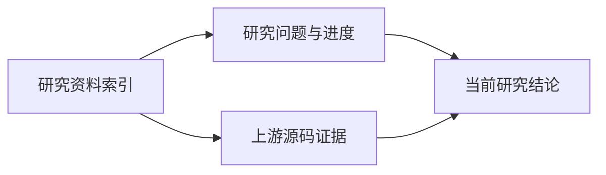

# R-001 研究资料索引

本文是研究资料的阅读入口。先阅读 [RESEARCH.md](../RESEARCH.md) 了解研究范围和问题，再阅读 [SYNTHESIS.md](../SYNTHESIS.md) 查看当前结论；专题证据保存在本目录。

## 资料目录

<!-- RCTL:NOTES:START -->
- [OpenTelemetry Java Agent Distro：Gradle、打包与测试机制](./distro-build-and-test.md)
- [OpenTelemetry Java Agent 上游架构证据（v2.32.0）](./upstream-analysis.md)
<!-- RCTL:NOTES:END -->

标记之间的目录由 `researchctl.py` 自动维护。标记之外的文字可以人工编辑。删除两个标记表示接管目录维护，此后同步操作不会自动修改该区域。
