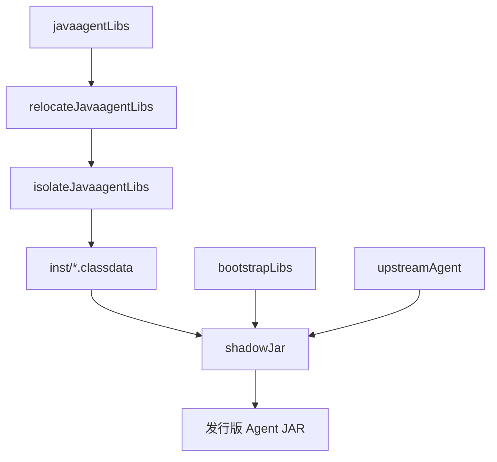

# OpenTelemetry Java Agent Distro：Gradle、打包与测试机制

Research：R-001；当前轮次：RR-001；基线：`opentelemetry-java-instrumentation v2.32.0`；研究日期：2026-10-23。

**证据范围：官方固定版本源码。尚未在 Datafox 构建或运行 Agent。** Datafox 已排除独立或内嵌 Extension JAR 发行路线；发行版内部仍允许使用官方 SPI。

## 1. Gradle 模块及职责

官方 [settings.gradle.kts](https://github.com/open-telemetry/opentelemetry-java-instrumentation/blob/v2.32.0/examples/distro/settings.gradle.kts) 声明如下项目：

| Project | 官方示例的职责 | Datafox 是否需要 |
|---|---|---|
| `:agent` | 最终 Java Agent 组装与 Manifest | 发行物构建入口 |
| `:bootstrap` | Bootstrap ClassLoader 可见的新增类 | 有对应类时才创建 |
| `:custom` | SDK、Resource、Sampler 等发行版自定义行为 | 有专有功能时才创建 |
| `:instrumentation:servlet-3` | 演示 Byte Buddy Instrumentation | 不照搬示例 |
| `:smoke-tests` | 最终 JAR 的运行与遥测验收 | 发行物必须验证 |
| `:testing:agent-for-testing` | 自定义 Instrumentation 测试用 Agent | 按测试需求引入 |
| `:instrumentation` | Instrumentation 子项目组织目录 | 无需额外 Java 逻辑 |

官方 `buildSrc` 包含 [Java 约定](https://github.com/open-telemetry/opentelemetry-java-instrumentation/blob/v2.32.0/examples/distro/buildSrc/src/main/kotlin/otel.java-conventions.gradle.kts)、[Instrumentation 约定](https://github.com/open-telemetry/opentelemetry-java-instrumentation/blob/v2.32.0/examples/distro/buildSrc/src/main/kotlin/otel.instrumentation-conventions.gradle.kts)、[Agent Shadow 约定](https://github.com/open-telemetry/opentelemetry-java-instrumentation/blob/v2.32.0/examples/distro/buildSrc/src/main/kotlin/otel.javaagent-shadow-conventions.gradle.kts)、[重定位规则](https://github.com/open-telemetry/opentelemetry-java-instrumentation/blob/v2.32.0/examples/distro/buildSrc/src/main/kotlin/Relocations.kt) 和 [版本常量](https://github.com/open-telemetry/opentelemetry-java-instrumentation/blob/v2.32.0/examples/distro/buildSrc/src/main/kotlin/Versions.kt)。这是示例的代码组织方式，不构成 Datafox 必须复制全部 `buildSrc` 的要求。

## 2. 三种 Configuration

[官方 `:agent` 依赖](https://github.com/open-telemetry/opentelemetry-java-instrumentation/blob/v2.32.0/examples/distro/agent/build.gradle.kts)：

```kotlin
dependencies {
  bootstrapLibs(project(":bootstrap"))
  javaagentLibs(project(":custom"))
  javaagentLibs(project(":instrumentation:servlet-3"))
  upstreamAgent("io.opentelemetry.javaagent:opentelemetry-javaagent:$opentelemetryJavaagentVersion")
}
```

- `upstreamAgent`：发布的上游 Agent JAR，不复制或重新实现上游 Agent。
- `bootstrapLibs`：最终合入 Bootstrap ClassLoader 可见区域的新增库。
- `javaagentLibs`：新增 AgentClassLoader 库，必须经过 relocation、ServiceLoader 合并和 `inst/` 隔离。
- `compileOnly`：`:custom` 编译所需的 SDK、SPI 等接口，不重复打包 Agent 已提供的 API。

官方 `:custom` 示例包含 `javaagent-tooling` 的 `compileOnly`，因为演示的 `BootstrapPackagesConfigurer` 需要它。这属于内部 Tooling 使用案例，**不意味着 Datafox 的所有自定义模块都需要内部 API**。

## 3. Shadow 的三个阶段



1. `relocateJavaagentLibs`：对新增 Agent 库执行重定位和 `META-INF/services` 合并，排除上游 Bootstrap 已提供的 `opentelemetry-api`、`context`、`common` 等重复依赖。
2. `isolateJavaagentLibs`：将重定位产物放入 `inst/`，把 `.class` 改为 `.classdata`，过滤签名、Manifest 和部分 Maven 元数据。
3. `shadowJar`：合并上游 Agent、Bootstrap 库与隔离后的 Agent 库，合并 `inst/META-INF/services`，设置 `Main-Class`、`Agent-Class`、`Premain-Class`、`Can-Redefine-Classes`、`Can-Retransform-Classes` 和发行版版本信息。Agent 入口仍是 `io.opentelemetry.javaagent.OpenTelemetryAgent`。

源码：[Agent Shadow 约定](https://github.com/open-telemetry/opentelemetry-java-instrumentation/blob/v2.32.0/examples/distro/buildSrc/src/main/kotlin/otel.javaagent-shadow-conventions.gradle.kts)。

[Relocations.kt](https://github.com/open-telemetry/opentelemetry-java-instrumentation/blob/v2.32.0/examples/distro/buildSrc/src/main/kotlin/Relocations.kt) 包括 `io.opentelemetry.instrumentation`、`io.opentelemetry.api`、`context`、`common`、`semconv` 的 Agent shaded 命名空间，以及 `java.util.logging.Logger` 到 `PatchLogger` 的特殊重定位。不能将普通 Fat JAR 合并等同于上述机制，也不应无验证地删减上游重定位规则。

## 4. Bootstrap 与 Instrumentation

[Bootstrap 示例类](https://github.com/open-telemetry/opentelemetry-java-instrumentation/blob/v2.32.0/examples/distro/bootstrap/src/main/java/com/example/javaagent/bootstrap/AgentApi.java) 可被 Agent 和注入应用 ClassLoader 的 Helper 共同访问。[DemoBootstrapPackagesProvider](https://github.com/open-telemetry/opentelemetry-java-instrumentation/blob/v2.32.0/examples/distro/custom/src/main/java/com/example/javaagent/DemoBootstrapPackagesProvider.java) 通过 `BootstrapPackagesConfigurer` 注册包，以适配 OSGi 等不完全委托 Bootstrap 的环境。没有新增 Bootstrap 类时，不应提前依赖该内部 Tooling 扩展点。

[Servlet InstrumentationModule](https://github.com/open-telemetry/opentelemetry-java-instrumentation/blob/v2.32.0/examples/distro/instrumentation/servlet-3/src/main/java/com/example/javaagent/instrumentation/DemoServlet3InstrumentationModule.java) 通过 `@AutoService` 注册，并实现 `order()`、`classLoaderMatcher()`、`typeInstrumentations()`、`isHelperClass()`。其 [Advice](https://github.com/open-telemetry/opentelemetry-java-instrumentation/blob/v2.32.0/examples/distro/instrumentation/servlet-3/src/main/java/com/example/javaagent/instrumentation/DemoServlet3Instrumentation.java) 修改 HTTP 响应头 `X-server-id` 仅用于演示；Datafox 不应照搬这种改变应用业务行为的示例。

[官方 Muzzle 文档](https://github.com/open-telemetry/opentelemetry-java-instrumentation/blob/v2.32.0/docs/contributing/muzzle.md)区分：构建期 `muzzle-generation` 生成符号与 Helper 引用；运行时 Muzzle 检查第三方 API 兼容性，不兼容则跳过 Instrumentation；`muzzle-check` 提供 `muzzle` 和 `printMuzzleReferences` 构建任务，可用 `assertInverse` 检查版本范围。只有实际新增 Instrumentation 后才需要对应的测试和 Muzzle 配置。

## 5. 两级测试

**Instrumentation 测试**：官方 [测试约定](https://github.com/open-telemetry/opentelemetry-java-instrumentation/blob/v2.32.0/examples/distro/buildSrc/src/main/kotlin/otel.instrumentation-conventions.gradle.kts) 使用 `testing:agent-for-testing`、`-javaagent`、`otel.javaagent.experimental.initializer.jar` 和 `AgentInstrumentationExtension`，验证 Advice、Helper 和 Span 行为。

**发行包 Smoke Test**：官方 [SmokeTest](https://github.com/open-telemetry/opentelemetry-java-instrumentation/blob/v2.32.0/examples/distro/smoke-tests/src/test/java/com/example/javaagent/smoketest/SmokeTest.java) 使用 Testcontainers 启动目标应用与模拟 OTLP 后端，将最终 `:agent:shadowJar` 作为 `-javaagent` 注入 JVM。[SpringBootSmokeTest](https://github.com/open-telemetry/opentelemetry-java-instrumentation/blob/v2.32.0/examples/distro/smoke-tests/src/test/java/com/example/javaagent/smoketest/SpringBootSmokeTest.java) 检查实际 Span、Resource 属性和发行版版本信息。构建成功本身不足以证明发行版可用。

Datafox 首个运行原型应验证：Manifest 和 `Premain-Class`、`inst/` 隔离布局、Agent 启动、HTTP 服务端 Span、OTLP 接收、显式 `otel.*` 配置优先级。新增 Instrumentation 时再补 Muzzle、Helper 和类加载兼容性测试。

## 6. 研究判断与待验证事项

**已确认的上游契约**：发行版使用发布的上游 Agent；新增 Agent/Bootstrap 库按 ClassLoader 分层打包；内部 SPI 与 Alpha 工具需要限制依赖；运行级别测试必须检查实际遥测。

**尚未决定的 Datafox 工程结构**：是否真正需要 `:bootstrap`、`:custom`、`:instrumentation`、`:testing:agent-for-testing`，以及是否抽取 Gradle `buildSrc` 约定插件。按实际功能和复用价值决定，不为演示功能增加模块。

**未执行的验证**：没有在 Datafox 执行 Gradle 构建、Muzzle、Agent 启动、OTLP 收集、ClassLoader 兼容性或性能测试。下一步是以 `v2.32.0` 为基线的 GitHub Actions Distro 原型。
