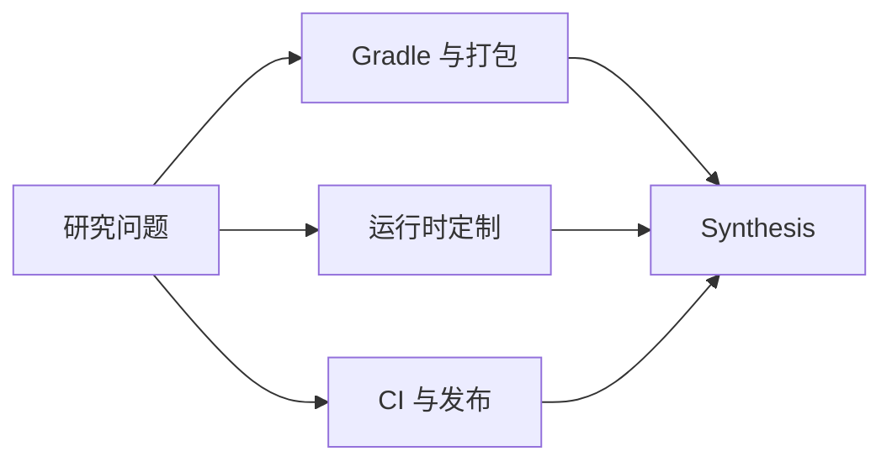

# R-002 · Splunk Java Agent 架构研究资料

本目录记录 Splunk `v2.32.0` 的源码证据。阅读顺序：先看 [Research](../RESEARCH.md) 了解问题与范围，再看 [Synthesis](../SYNTHESIS.md) 获取结论，最后查阅专题证据。

## 资料目录

<!-- RCTL:NOTES:START -->
- [Splunk Gradle 工程、模块与 Agent 打包](./gradle-and-packaging.md)
- [Splunk 运行时定制、配置与产品能力](./runtime-customizations.md)
- [Splunk CI、兼容性与发布工程](./ci-release.md)
<!-- RCTL:NOTES:END -->

目录标记由 RepoFoundryAI 的 `researchctl` 自动维护。文件名和技术 API 保持原样，文档正文使用中文。
