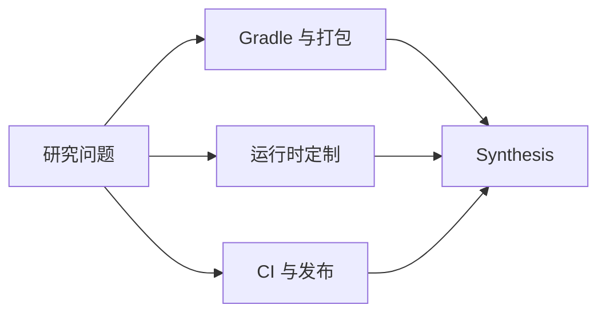

# R-002 · Splunk Java Agent 架构研究资料

本目录记录 Splunk `v2.32.0` 的源码证据。阅读顺序：先看 [Research](../RESEARCH.md) 了解问题与范围，再看 [Synthesis](../SYNTHESIS.md) 获取结论，最后查阅专题证据。

## 资料目录

<!-- RCTL:NOTES:START -->
- [Splunk Java Agent build.gradle.kts 深入解读](./build-gradle-deep-dive.md)
- [Splunk Java Agent 工程流程、测试与发布](./ci-release.md)
- [Splunk Java Agent 发行版架构与 Gradle 构建](./gradle-and-packaging.md)
- [Splunk 发行版专有能力与运行时接入机制](./runtime-customizations.md)
<!-- RCTL:NOTES:END -->

目录标记由 RepoFoundryAI 的 `researchctl` 自动维护。文件名和技术 API 保持原样，文档正文使用中文。
