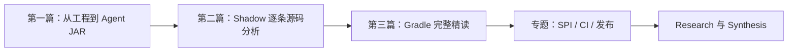

# R-002 · Splunk Java Agent 架构研究资料

本目录记录 Splunk `v2.32.0` 的源码研究。**不必先阅读 Research 的状态表和结论表**；如果目标是理解 Splunk 怎样构建 Agent，请先打开 [从 Gradle 工程到最终 Agent JAR](./gradle-and-packaging.md)。这篇按“看到什么代码、它解决什么问题、Datafox 该如何处理”的顺序解释。下一步读 [Shadow 构建插件逐条源码解读](./shadow-conventions-source-walkthrough.md)，理解 relocation、SPI 合并和资源处理。最后需要查询整个 Gradle 工程的完整细节时，再看 [build.gradle.kts 源码精读](./build-gradle-deep-dive.md)。

想直接查研究结论，可以打开 [Synthesis](../SYNTHESIS.md)；要了解研究问题、范围和状态，再查看 [Research](../RESEARCH.md)。

## 阅读建议

**只想弄清 Splunk 为什么要三种 Configuration、三个 Shadow 任务？** 读 [渐进式导读](./gradle-and-packaging.md) 即可。

**准备真正配置 Datafox 的 Gradle？** 先读 [Shadow 源码分析](./shadow-conventions-source-walkthrough.md)，再查 [完整 Gradle 源码精读](./build-gradle-deep-dive.md)；涉及 `:custom` 或 Instrumentation 再看 [运行时定制](./runtime-customizations.md)。

**只关心发行工程？** 直接看 [CI 与发布](./ci-release.md)。

## 资料目录

<!-- RCTL:NOTES:START -->
- [Splunk Java Agent 的 Gradle 工程与 `build.gradle.kts` 源码精读](./build-gradle-deep-dive.md)
- [Splunk Java Agent 工程流程、测试与发布](./ci-release.md)
- [读懂 Splunk Java Agent：从 Gradle 工程到一个可运行的 Agent JAR](./gradle-and-packaging.md)
- [Splunk 发行版专有能力与运行时接入机制](./runtime-customizations.md)
- [Splunk Shadow 构建插件精读：为什么这样重定位、合并和隔离？](./shadow-conventions-source-walkthrough.md)
<!-- RCTL:NOTES:END -->

目录标记由 RepoFoundryAI 的 `researchctl` 自动维护。文件名和技术 API 保持原样，文档正文使用中文。
