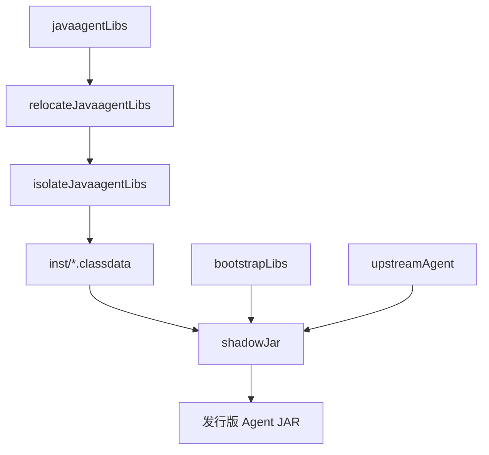

# Splunk Java Agent build.gradle.kts 深入解读

Research：R-002；源码基线：`signalfx/splunk-otel-java@v2.32.0`；2026-10-23。仅进行源码分析，不代表 Datafox 已执行 Gradle。

## 构建职责分层

| 文件 | 职责 |
|---|---|
| [根 build.gradle.kts](https://github.com/signalfx/splunk-otel-java/blob/v2.32.0/build.gradle.kts) | 发行版版本、公共插件、发布仓库与子项目约定 |
| [settings.gradle.kts](https://github.com/signalfx/splunk-otel-java/blob/v2.32.0/settings.gradle.kts) | 模块注册、插件解析 |
| [agent/build.gradle.kts](https://github.com/signalfx/splunk-otel-java/blob/v2.32.0/agent/build.gradle.kts) | Agent 依赖、Shadow 三阶段打包、Manifest、发行物 |
| [splunk.shadow-conventions.gradle.kts](https://github.com/signalfx/splunk-otel-java/blob/v2.32.0/buildSrc/src/main/kotlin/splunk.shadow-conventions.gradle.kts) | 依赖重定位、ServiceLoader 合并、Shadow 约定 |
| [dependencyManagement/build.gradle.kts](https://github.com/signalfx/splunk-otel-java/blob/v2.32.0/dependencyManagement/build.gradle.kts) | java-platform、BOM 与版本约束 |
| [version.gradle.kts](https://github.com/signalfx/splunk-otel-java/blob/v2.32.0/version.gradle.kts) | Splunk 发行版版本 |

根构建负责通用配置，不负责具体 Agent 类加载隔离。Splunk 通过 `buildSrc` 的预编译约定插件统一 Java、Spotless、Instrumentation 和 Shadow 规则；`dependencyManagement` 使用 `java-platform` 和 `enforcedPlatform` 约束 SDK、Instrumentation 及第三方依赖。强制 BOM 是 Splunk 的工程选择，不是所有发行版必须照搬的契约。

## 三种 Gradle Configuration

`agent/build.gradle.kts` 定义三个可解析、不可消费的 Configuration：

- `upstreamAgent`：已发布的官方 `io.opentelemetry.javaagent:opentelemetry-javaagent`。
- `bootstrapLibs`：Bootstrap ClassLoader 可见的发行版类。
- `javaagentLibs`：`:custom`、`:opamp`、`:profiler` 和专有 Instrumentation 等 AgentClassLoader 类库。

Splunk 还通过检测子项目应用 `splunk.instrumentation-conventions` 插件，将 Instrumentation 动态添加到 `javaagentLibs`；这是规模化模块管理方法。Datafox 模块少时优先显式声明。

## Shadow 三阶段打包

1. `relocateJavaagentLibs`：Shadow 合并新增 Agent 依赖、执行包名重定位、合并 SPI 服务描述文件，排除上游 Bootstrap 已提供的重复 API 依赖。
2. `isolateJavaagentLibs`：把新增 Agent 类和资源移动到 `inst/`，将 `.class` 后缀改为 `.classdata`。字节码内容没有变成新格式；该布局由上游 AgentClassLoader 处理。
3. `shadowJar`：合并 Bootstrap 库、上游 Agent 与隔离后的 Agent 类；处理 `inst/META-INF/services`，设置 Manifest，得到最终发行物。

单纯构建普通 Fat JAR 无法替代上游的 `inst/` 隔离。具体重定位规则应以固定版本的 Shadow 约定文件为准，不应只凭示例代码片段推断全部规则。

## Manifest 和启动入口

Splunk 最终发行包的 `Main-Class` 指向 `io.opentelemetry.javaagent.OpenTelemetryAgent`，`Premain-Class` 和 `Agent-Class` 指向 `com.splunk.opentelemetry.javaagent.SplunkAgent`。

[SplunkAgent.java](https://github.com/signalfx/splunk-otel-java/blob/v2.32.0/bootstrap/src/main/java/com/splunk/opentelemetry/javaagent/SplunkAgent.java) 的 `premain` 调用自身 `agentmain`，最终委托 `OpenTelemetryAgent.agentmain`。这是薄入口，不是 SDK 或 Agent 初始化器 Fork。Datafox 若无启动前需求，可以直接沿用上游入口。

## 依赖与版本管理

Splunk 将发行版版本放在 `version.gradle.kts`，将 SDK/Instrumentation 版本约束放在 `dependencyManagement`；在 `v2.32.0` 源码中 SDK 为 `1.66.0`，Instrumentation 为 `2.32.0`。发行版版本与上游版本是两个独立概念。

`enforcedPlatform` 会对依赖解析施加强制约束，Datafox 应根据真实依赖规模与冲突风险决定是否采用相同模式。

## 对 Datafox 的具体建议

- **优先参考 Splunk 的工程结构与 Gradle 打包方式**；OpenTelemetry 官方源码负责定义 ClassLoader、SPI 和生命周期契约。
- 采用 `upstreamAgent` / `bootstrapLibs` / `javaagentLibs` 边界及 Shadow 三阶段组装。
- 保留发布的上游 Agent，不 Fork SDK；不使用独立或嵌入式 Extension JAR 发行路线。
- 参考 `buildSrc` 和 `dependencyManagement`，但按实际复用价值决定是否立即创建。
- 没有实际功能时不增加空的 Bootstrap、Instrumentation、Profiler 或 OpAMP 模块。
- 不照搬 Splunk 专有 Realm/Token、SpanLimits、内部 Tooling 和商用发布集成。

## 研究限制

本次没有运行 Gradle、JAR 解包、JVM 启动或性能测试。研究内容是源码解释与工程建议，不能当作 Datafox 已通过的构建结果。
