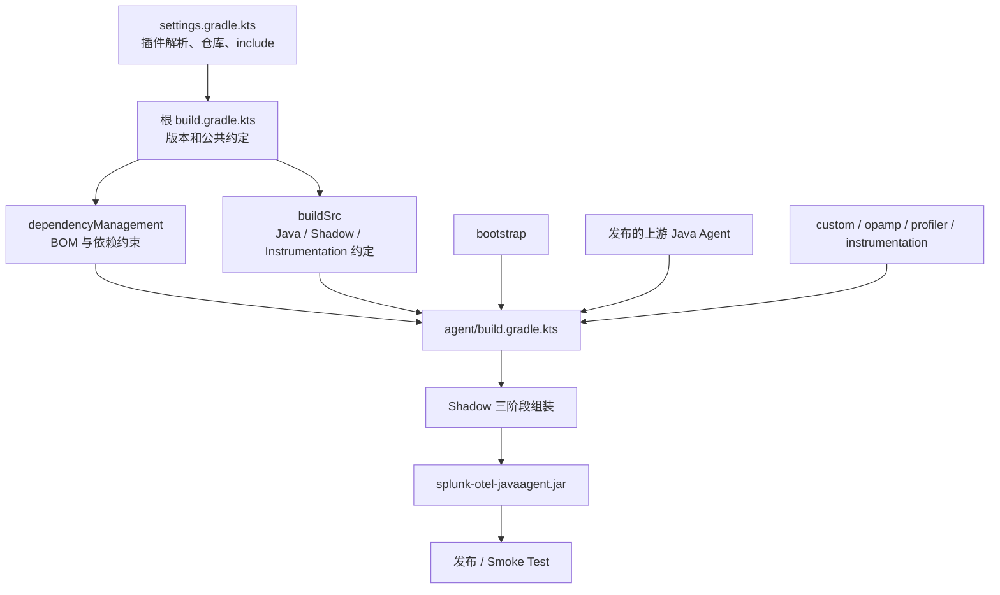
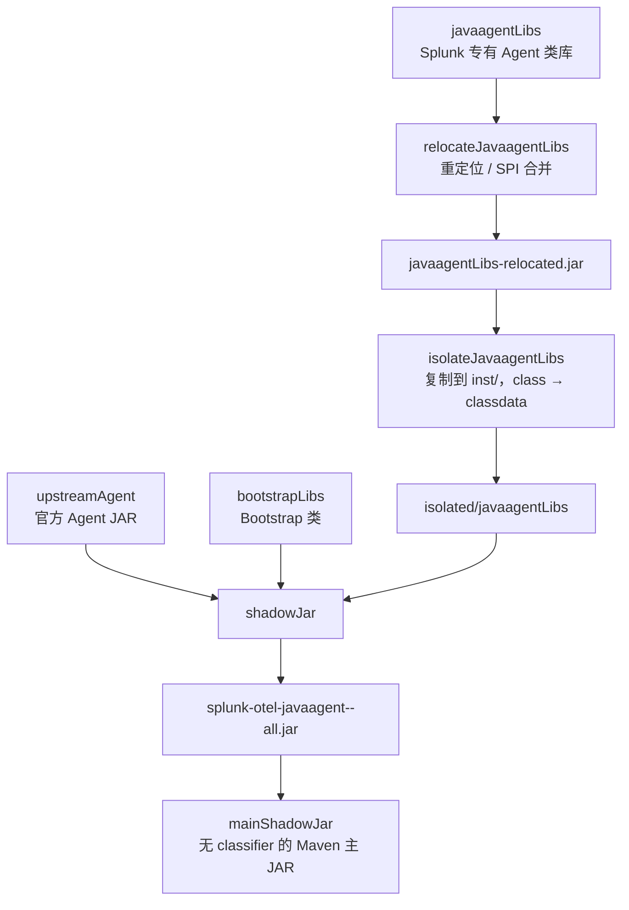
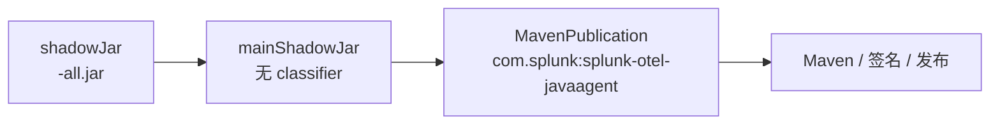

# Splunk Java Agent 的 Gradle 工程与 `build.gradle.kts` 源码精读

> Research：R-002 / RR-001 · 固定基线：[`signalfx/splunk-otel-java@v2.32.0`](https://github.com/signalfx/splunk-otel-java/tree/v2.32.0) · 2026-10-23  
> 研究方法：阅读固定版本的 Kotlin DSL、约定插件、Java 启动器及发布脚本。**本文解释上游源码，不代表 Datafox 已创建或成功构建 Agent。**  
> 讨论范围：Splunk 主发行版的 `build.gradle.kts` 系列文件，不把实验性的 `:agent-csa-bundle` 当作常规打包路径。

## 0. 先回答构建机制是什么

Splunk 的发行版构建由四个层次协作：

1. **Gradle 工程配置层**：`settings.gradle.kts` 注册所有 Project，并确定插件和仓库来源。
2. **根构建与约定层**：根 `build.gradle.kts` 和 `buildSrc` 统一版本、Java 约定、格式、Shadow 规则；`dependencyManagement` 约束依赖版本。
3. **发行版组装层**：`:agent` 从 Maven 获取官方 Java Agent，按 Bootstrap 与 AgentClassLoader 边界打包 Splunk 自有类，生成最终 Java Agent JAR。
4. **产品与交付层**：`:custom`、`:instrumentation:*`、`:opamp`、`:profiler` 实现产品差异；`smoke-tests`、Maven 发布和其他打包任务使用最终产物。



**核心判断**：Splunk 不是将 OpenTelemetry Java Instrumentation 整个源码项目复制进来重新构建。其 `upstreamAgent` 依赖已发布的 `io.opentelemetry.javaagent:opentelemetry-javaagent`；Splunk 添加的类和依赖按官方 ClassLoader 结构做差异化封装。

固定源码入口：[根脚本](https://github.com/signalfx/splunk-otel-java/blob/v2.32.0/build.gradle.kts) · [Agent 脚本](https://github.com/signalfx/splunk-otel-java/blob/v2.32.0/agent/build.gradle.kts) · [Shadow 约定](https://github.com/signalfx/splunk-otel-java/blob/v2.32.0/buildSrc/src/main/kotlin/splunk.shadow-conventions.gradle.kts)。

## 1. `settings.gradle.kts`：在配置阶段确定工程边界

### 1.1 插件版本集中注册

固定版本的 [`settings.gradle.kts`](https://github.com/signalfx/splunk-otel-java/blob/v2.32.0/settings.gradle.kts) 通过 `pluginManagement { plugins { ... } }` 声明 Docker、Nexus 发布、许可证报告与 Shadow 插件版本。例如：

```kotlin
pluginManagement {
  plugins {
    id("io.github.gradle-nexus.publish-plugin") version "2.0.0"
    id("com.gradleup.shadow") version "9.6.1"
  }
}
```

这允许子项目直接按 ID 引入插件，避免每个子项目重复写版本。Splunk 还使用 `com.gradle.develocity` 的 Build Scan；是否上传与 `CI` 环境变量有关。Build Scan 属于构建可观测性，不影响最终 Agent 的字节码布局。

### 1.2 依赖仓库不同于插件仓库

`pluginManagement.repositories` 影响**Gradle 插件解析**；`dependencyResolutionManagement.repositories` 影响**项目依赖解析**。Splunk 在有 `MAVEN_REPOSITORY_URL` 时使用企业 Artifactory，否则使用 Maven Central，另外配置 Sonatype Snapshot 和一个用于特定 GitHub Release 制品的 Ivy 仓库。

因此，不应把这里的 Ivy GitHub Release 仓库理解为 OpenTelemetry Java Agent 的主要依赖来源，也不能因为 Splunk 有该仓库就复制到 Datafox。它服务于 Splunk 的额外产品捆绑依赖。

### 1.3 模块 `include` 决定“参与构建”，不决定“进入 Agent”

`settings.gradle.kts` 注册 `:agent`、`:bootstrap`、`:custom`、`:dependencyManagement`、`:instrumentation:*`、`:opamp`、`:profiler`、`:smoke-tests`、测试工具及元数据生成等 Project。

**`include(":opamp")` 并不意味着其字节码自动进入最终 Agent。** 是否参与最终 Agent 由 `:agent` 的 `javaagentLibs` / `bootstrapLibs` 依赖决定。这是理解 Gradle Project 图与发行包内容图的关键区别。

## 2. 根 `build.gradle.kts`：只承载跨模块策略

官方源码中的根脚本主要做三件事：

```kotlin
plugins {
  id("idea")
  id("io.github.gradle-nexus.publish-plugin")
}

apply(from = "version.gradle.kts")

group = "com.splunk"

subprojects {
  version = rootProject.version
  if (this.name != "dependencyManagement") {
    apply(plugin = "splunk.java-conventions")
    apply(plugin = "splunk.spotless-conventions")
  }
}
```

这是核心结构节选，省略了 `nexusPublishing` 和 CI 依赖缓存设置。逐项解释：

- `idea` 提供 IntelliJ IDEA 工程支持；不是发行版运行时插件。
- `io.github.gradle-nexus.publish-plugin` 配置向 Sonatype / Maven Central 的发布路径。根脚本通过 `nexusPublishing` 设置仓库和认证，凭据从环境变量读取。
- `apply(from = "version.gradle.kts")` 加载**发行版自身版本**。固定标签下 `distroVersion = "2.32.0"`，并应用到 `allprojects`。
- `group = "com.splunk"` 设置根项目坐标；`:agent` 的 Maven Publication 进一步显式设置发布坐标。
- `subprojects` 给子项目统一设置版本，并对常规 Java 模块应用 Java 和 Spotless 约定；排除 `:dependencyManagement`，因为它是 `java-platform` 而非普通 Java 源码模块。
- 在 CI 中，Splunk 将 `changing` 模块的缓存有效期设置为零，意在避免 Snapshot 依赖长时间复用旧内容；这会增加网络解析频率，并非普遍需要。

**为何根脚本较短？** Agent 的封装规则依赖具体 ClassLoader 和 Artifact 类型，不适合放到所有子项目上执行；Splunk 将它们留给 `:agent` 和 Shadow 约定插件。

源码：[根 build.gradle.kts](https://github.com/signalfx/splunk-otel-java/blob/v2.32.0/build.gradle.kts) · [version.gradle.kts](https://github.com/signalfx/splunk-otel-java/blob/v2.32.0/version.gradle.kts)。

## 3. `buildSrc`：把 Gradle 约定与业务依赖声明分开

`buildSrc` 是 Gradle 会识别的构建逻辑目录。Splunk 的 [`buildSrc/build.gradle.kts`](https://github.com/signalfx/splunk-otel-java/blob/v2.32.0/buildSrc/build.gradle.kts) 应用 `kotlin-dsl`，引入 Shadow、Spotless 以及 OpenTelemetry Instrumentation Gradle 插件依赖，使预编译约定插件能够使用这些类型和功能。

| 约定插件 | 代码职责 | 影响范围 |
|---|---|---|
| [`splunk.java-conventions`](https://github.com/signalfx/splunk-otel-java/blob/v2.32.0/buildSrc/src/main/kotlin/splunk.java-conventions.gradle.kts) | Java、JUnit、测试日志、公共依赖平台、JAR 重复资源策略 | 常规 Java Project |
| [`splunk.spotless-conventions`](https://github.com/signalfx/splunk-otel-java/blob/v2.32.0/buildSrc/src/main/kotlin/splunk.spotless-conventions.gradle.kts) | Java 格式、Kotlin DSL 格式、许可证头、文本格式 | 代码风格 |
| [`splunk.shadow-conventions`](https://github.com/signalfx/splunk-otel-java/blob/v2.32.0/buildSrc/src/main/kotlin/splunk.shadow-conventions.gradle.kts) | Shadow、SPI 合并、包名重定位 | Agent 以及相关测试 Shadow 任务 |
| [`splunk.instrumentation-testing-conventions`](https://github.com/signalfx/splunk-otel-java/blob/v2.32.0/buildSrc/src/main/kotlin/splunk.instrumentation-testing-conventions.gradle.kts) | Instrumentation 依赖、测试 Agent、测试 JVM 参数、最新库版本测试 | Instrumentation |
| [`splunk.muzzle-conventions`](https://github.com/signalfx/splunk-otel-java/blob/v2.32.0/buildSrc/src/main/kotlin/splunk.muzzle-conventions.gradle.kts) | Muzzle 代码生成、兼容性检查和对应 Tooling 依赖 | 需要 Muzzle 的模块 |

注意两处实际工程细节：

第一，`splunk.instrumentation-conventions` 本身很薄，主要引用 `splunk.instrumentation-testing-conventions`。因此，给 Instrumentation 模块应用“公共约定”并不只是格式设置，还可能配置测试 Agent、依赖注入和 Java Instrumentation 测试机制。

第二，`splunk.muzzle-conventions` 是**独立、按需应用**的插件。Splunk 源码注释说明个别项目在统一开启 Muzzle 时会触发 Gradle 解压错误，因此没有全局强制套用。

**对 Datafox 的判断**：Shadow relocation 涉及可复用、较复杂的构建逻辑时，参考 Splunk 提取约定插件是合理的；但不要为了模仿 `buildSrc` 结构而预先复制五套插件。提取规则应以实际重复或脚本复杂度为依据。

## 4. `dependencyManagement`：版本平台与 Gradle 依赖配置的关系

源码：[dependencyManagement/build.gradle.kts](https://github.com/signalfx/splunk-otel-java/blob/v2.32.0/dependencyManagement/build.gradle.kts)。

Splunk 使用：

```kotlin
plugins {
  `java-platform`
}

javaPlatform {
  allowDependencies()
}
```

`java-platform` 产出的是依赖版本平台，不是用于 JVM 的 Java 类库。`allowDependencies()` 允许这个 Platform 引入其他 BOM。

其版本组织包括：

- `otelVersion = "1.66.0"`，对应 SDK；
- `otelInstrumentationVersion = "2.32.0"`，对应 Agent/Instrumentation；
- 各自派生的 `-alpha` 版本；
- 单独声明 Contrib、Jackson、Protobuf、SLF4J、JUnit、Testcontainers 等生态依赖。

例如（节选）：

```kotlin
dependencies {
  api(enforcedPlatform(
    "io.opentelemetry:opentelemetry-bom-alpha:$otelAlphaVersion"
  ))
  api(enforcedPlatform(
    "io.opentelemetry.instrumentation:opentelemetry-instrumentation-bom-alpha:$otelInstrumentationAlphaVersion"
  ))
  constraints {
    api("org.slf4j:slf4j-api:$slf4jVersion")
  }
}
```

**BOM 与 constraints 不相同**：BOM 为一组已知依赖提供版本约束；`constraints` 可以为未由 BOM 或需要特殊协调的单个依赖指定版本。Splunk 使用 `enforcedPlatform` 使版本约束具备强制性，因此版本冲突和传递依赖选择都受到影响。

在 [`splunk.java-conventions`](https://github.com/signalfx/splunk-otel-java/blob/v2.32.0/buildSrc/src/main/kotlin/splunk.java-conventions.gradle.kts) 中，Splunk 建立不可解析的 `dependencyManagement` Configuration，然后把这个平台依赖继承到可解析、不可消费的配置。结果是多个子项目的 `testImplementation`、`compileClasspath` 等依赖解析统一受该平台约束。

而 `:agent` 需要注意一个额外事实：它的三个自定义可解析 Configuration 并非普通 Java 默认配置。脚本显式执行：

```kotlin
add("upstreamAgent", platform(project(":dependencyManagement")))
```

这保证 `upstreamAgent` 的版本受平台管理。其他自定义配置的继承关系依赖公共约定插件。**不能假设所有自定义 Configuration 会自动继承普通 Java 的 BOM**，设计 Datafox 时要检查 Gradle 的实际继承或显式加上平台。

### 版本治理与发布版本分离

`version.gradle.kts` 的 Splunk 发行版版本，与 `dependencyManagement` 中的 OTel SDK、Instrumentation 版本相互独立。即使当期 Splunk 与 Instrumentation 均为 `2.32.0`，这也不是必须同步递增的 Gradle 语义。

对 Datafox 应将“自身发行版本”“上游 Agent 版本”“SDK/BOM 版本”分别建模，但无需提前复制 Splunk 全量 BOM/constraints。

## 5. `:agent`：从多模块依赖得到一个最终发行物

源码：[agent/build.gradle.kts](https://github.com/signalfx/splunk-otel-java/blob/v2.32.0/agent/build.gradle.kts)。

### 5.1 插件和产物约定

`:agent` 应用 `maven-publish`、`signing`、`splunk.shadow-conventions` 和许可证报告插件；设置 `base.archivesName = "splunk-otel-javaagent"`，声明 Sources/Javadoc JAR 作为发布物。

这是打包与发布共存的 Gradle Project。**Shadow 任务负责 Agent 结构，Maven Publication 负责交付坐标，两者不是一个概念。**

### 5.2 三种可解析、不可消费的 Configuration

```kotlin
val bootstrapLibs = configurations.create("bootstrapLibs") {
  isCanBeResolved = true
  isCanBeConsumed = false
}
val javaagentLibs = configurations.create("javaagentLibs") {
  isCanBeResolved = true
  isCanBeConsumed = false
}
val upstreamAgent = configurations.create("upstreamAgent") {
  isCanBeResolved = true
  isCanBeConsumed = false
}
```

**Gradle 的 Configuration 是依赖解析与变体消费的概念，不等于 ClassLoader 本身。** Splunk 后续的 Shadow 和 Copy 任务根据 Configuration 选择不同的打包布局，最终才形成 JVM 的类加载边界。

| Configuration | 实际内容 | 由谁消费 | 结果 |
|---|---|---|---|
| `upstreamAgent` | 官方已发布的 Java Agent | 最终 `shadowJar` | 复用官方已封装的 Agent |
| `bootstrapLibs` | `:bootstrap` 等 Bootstrap 可见类 | 最终 `shadowJar` | Bootstrap 区域 |
| `javaagentLibs` | `:custom`、`:opamp`、`:profiler`、Instrumentations | relocation → isolation → 最终 `shadowJar` | `inst/` 和 `.classdata` |
| `licenseReportDependencies` | 继承 Bootstrap/Agent 库 | 许可证报告 | 不决定 ClassLoader |

Splunk 的关键依赖（节选）：

```kotlin
dependencies {
  bootstrapLibs(project(":bootstrap"))
  javaagentLibs(project(":custom"))
  javaagentLibs(project(":opamp"))
  javaagentLibs(project(":profiler"))
  upstreamAgent("io.opentelemetry.javaagent:opentelemetry-javaagent")
}
```

`upstreamAgent` 是 Maven 发布的 Agent，不是整个 `opentelemetry-java-instrumentation` 源码的 Included Build。Splunk 特有功能通过 `javaagentLibs` 加入统一装配。

### 5.3 Instrumentation 子项目为什么不用逐个列出？

Splunk 遍历 `:instrumentation` 的子项目，监听是否应用 `splunk.instrumentation-conventions`，若应用，则将该子项目添加到 `javaagentLibs`。

这是一种**约定驱动的打包模块发现机制**，适合项目有大量 JDBC、应用服务器、No-code 等 Instrumentation 的情况。它依赖插件应用顺序和子项目注册关系，增加一定构建脚本隐式性。

Datafox 初期如果只有少数模块，应优先：

```kotlin
javaagentLibs(project(":custom"))
javaagentLibs(project(":instrumentation:my-feature"))
```

而不是预先实现动态模块收集。等确有数量和管理成本时再复用 Splunk 的办法。

## 6. Shadow：为什么必须分成三个任务？



这不是三个同义的 Fat JAR 任务。三阶段分别解决了**命名空间冲突、资源布局隔离、最终聚合**的问题。

### 6.1 第一阶段：`relocateJavaagentLibs`

精简代码：

```kotlin
val relocateJavaagentLibs = register<ShadowJar>("relocateJavaagentLibs") {
  configurations = listOf(javaagentLibs)
  duplicatesStrategy = DuplicatesStrategy.FAIL
  archiveFileName.set("javaagentLibs-relocated.jar")
}
```

实际的 `relocate` 和 SPI 合并规则，主要通过 `splunk.shadow-conventions` 应用于所有相关 ShadowJar，而不是全部手写在这一任务里。

**重定位是在合并新增 Agent 依赖时改写类引用及相应包路径**，使其引用 Agent 使用的 shaded 类，减少与 Application ClassLoader 的同名类冲突。Splunk 还排除已由上游 Bootstrap 供给的 API、Context、Common、Semconv 及 SLF4J 相关依赖。

这是一个易错点：**`compileOnly` 与 Shadow 的 `exclude(dependency(...))` 处理的不是同一层问题**。前者让发行版模块的编译 API 不直接成为运行时依赖，后者防止 `javaagentLibs` 的传递依赖再次进入隔离产物。

### 6.2 `splunk.shadow-conventions` 的重定位规则

固定版本中值得逐条理解的规则：

| 原引用 | 目标引用 | 源码中的目的 |
|---|---|---|
| `org.slf4j` | `io.opentelemetry.javaagent.slf4j` | 防止与 JVM 应用自身 SLF4J 冲突，尤其是 premain |
| `java.util.logging.Logger` | `io.opentelemetry.javaagent.bootstrap.PatchLogger` | 适配 Agent 的日志行为 |
| `io.opentelemetry.instrumentation` | `io.opentelemetry.javaagent.shaded.instrumentation` | 与应用侧 Instrumentation API 隔离 |
| `io.opentelemetry.api` | `io.opentelemetry.javaagent.shaded.io.opentelemetry.api` | Agent API 使用上游 shaded 命名空间 |
| `io.opentelemetry.context` | `io.opentelemetry.javaagent.shaded.io.opentelemetry.context` | Agent Context 引用隔离 |
| `io.opentelemetry.common` | `io.opentelemetry.javaagent.shaded.io.opentelemetry.common` | Common 模块隔离 |
| `io.opentelemetry.semconv` | `io.opentelemetry.javaagent.shaded.io.opentelemetry.semconv` | 语义约定引用隔离 |
| 部分 Contrib/Kotlin 扩展包 | `io.opentelemetry.javaagent.shaded...` | 满足对应 Instrumentation 的类加载结构 |

`io.opentelemetry.instrumentation` 的重定位中还排除了资源提供者包，例如 `io.opentelemetry.instrumentation.resources.*` 与 `io.opentelemetry.instrumentation.spring.resources.*`，因为相关类应留在 AgentClassLoader。

这些是固定版本实际的规则，不能简化为“把所有 `io.opentelemetry.*` 统一加 shaded 前缀”。**重定位范围、排除项、已由上游提供的依赖必须一起判断。**

还要区分两件事：日志类的重定位体现 Splunk 的运行环境要求；将它当作 Datafox 必须全部复制的强制规范，需要先确认 Datafox 是否打入相同日志依赖。

### 6.3 ServiceLoader 合并并非普通资源去重

Shadow 约定包含：

```kotlin
mergeServiceFiles()
filesMatching("META-INF/services/**") {
  duplicatesStrategy = DuplicatesStrategy.INCLUDE
}
```

`META-INF/services/<SPI-FQCN>` 文件内部是一组实现类名。多个 JAR 提供同一 SPI 时，如果像普通文件一样只保留其中一个，另一个提供者就可能无法被 ServiceLoader 发现。

Splunk 采取**先允许同路径 Service 文件输入、再由 Shadow ServiceFileTransformer 合并文本内容**的处理，而不是简单 `EXCLUDE` 其中一个。

`javaagentLibs` 完成隔离后，Service 资源也随之落在 `inst/META-INF/services/`。最终 `shadowJar` 再对该位置执行专门合并：

```kotlin
mergeServiceFiles("inst/META-INF/services")
filesMatching("inst/META-INF/services/**") {
  duplicatesStrategy = DuplicatesStrategy.INCLUDE
}
```

**两个位置的合并不可互换**：第一次面对未经隔离的新增依赖，第二次面对上游 Agent 已经包含的 `inst/` 服务文件与新加入的服务文件。这解释了为什么即便最外层采用 `DuplicatesStrategy.EXCLUDE`，特定 Service 目录仍要设置 `INCLUDE`。

### 6.4 第二阶段：`isolateJavaagentLibs`

Splunk 的 Copy 任务依赖第一阶段：

```kotlin
val isolateJavaagentLibs = register<Copy>("isolateJavaagentLibs") {
  dependsOn(relocateJavaagentLibs)
  isolateClasses(relocateJavaagentLibs.get().outputs.files)
  into(layout.buildDirectory.dir("isolated/javaagentLibs"))
}
```

对应 `isolateClasses` 在解包重定位产物时：

- `into("inst")`：新增 Agent 内容进入上游 AgentClassLoader 使用的目录；
- `rename("^(.*)\\.class$", "$1.classdata")`：普通 Java 类变为 `.classdata` 资源；
- 过滤 `META-INF/INDEX.LIST`、部分签名和 LICENSE，避免不适当的重复文件。

示意：

```text
输入：com/splunk/SomeAgentClass.class
输出：inst/com/splunk/SomeAgentClass.classdata
```

**`.classdata` 不是字节码编译目标**。字节码仍是 JVM Class 内容，改变的是容器内的名称和加载入口。这让应用普通 ClassLoader 不会按标准类资源发现 Agent 内部实现。

官方注释指出，将隔离步骤独立成任务，是为了在与上游 JAR 合并时准确控制重复文件策略：不同 CopySpec 的 `duplicatesStrategy` 不能只靠外层 ShadowJar 的一个设置来统一解决。

### 6.5 第三阶段：`shadowJar`

最终 Shadow：

```kotlin
shadowJar {
  configurations = listOf(bootstrapLibs, upstreamAgent)
  dependsOn(isolateJavaagentLibs)
  from(isolateJavaagentLibs.get().outputs)
  archiveClassifier.set("all")
  duplicatesStrategy = DuplicatesStrategy.EXCLUDE
  mergeServiceFiles("inst/META-INF/services")
}
```

这一阶段不再把 `javaagentLibs` 按普通 Java runtimeClasspath 打入根目录，而是只使用第二阶段的隔离产物。它负责组装：

1. 已发布、已带自有 `inst/` 结构的上游 Agent。
2. Bootstrap 可见的 Splunk 类和依赖。
3. `inst/` 下新增的 Splunk Agent 类和服务注册文件。
4. 构建 Manifest 和第三方许可证资源。

**不要对官方上游 Agent JAR 整体重复执行 isolation。** 它本身已经按官方布局封装。Splunk 只对新增 Agent 库执行这套增量隔离，最终与上游产物合并。

## 7. Manifest：`Main-Class`、`Premain-Class` 与 `Agent-Class` 的差异

在 `agent/build.gradle.kts` 中：

| Manifest 属性 | Splunk v2.32.0 |
|---|---|
| `Main-Class` | `io.opentelemetry.javaagent.OpenTelemetryAgent` |
| `Premain-Class` | `com.splunk.opentelemetry.javaagent.SplunkAgent` |
| `Agent-Class` | `com.splunk.opentelemetry.javaagent.SplunkAgent` |
| `Can-Redefine-Classes` | `true` |
| `Can-Retransform-Classes` | `true` |
| `Implementation-Vendor` | `Splunk` |
| `Implementation-Version` | 带 Splunk 版本和上游 OTel 版本的字符串 |

其中 `Premain-Class` 用于 `-javaagent` 启动，`Agent-Class` 用于 Agent attach，`Main-Class` 用于 JAR 的主入口语义；这些字段不能因名字接近而混作一个。

源码 [`SplunkAgent.java`](https://github.com/signalfx/splunk-otel-java/blob/v2.32.0/bootstrap/src/main/java/com/splunk/opentelemetry/javaagent/SplunkAgent.java)：

```java
public static void premain(String agentArgs, Instrumentation inst) {
  agentmain(agentArgs, inst);
}

public static void agentmain(String agentArgs, Instrumentation inst) {
  OpenTelemetryAgent.agentmain(agentArgs, inst);
}
```

Splunk 的专有入口**并没有重新实现 SDK 或 Instrumentation 初始化**，只是向官方 Agent 的 `agentmain` 委托。这个类属于 `:bootstrap` 模块，最终 Manifest 指向它。对 Datafox，如果当前没有早于上游 Agent 的启动逻辑，优先保留上游官方 Manifest 入口即可，避免添加纯品牌委托。

## 8. 产物为何同时有 `shadowJar` 与 `mainShadowJar`？

Splunk 把 `shadowJar` 的 `archiveClassifier` 设为 `all`，得到：

```text
splunk-otel-javaagent-2.32.0-all.jar
```

接着用 `mainShadowJar` 创建**无 classifier** 的另一份 Agent JAR 内容，并复制 Shadow 的 Manifest。目的是满足它选择的 Sonatype / Maven Publication 主制品约定。



源码：[agent/build.gradle.kts](https://github.com/signalfx/splunk-otel-java/blob/v2.32.0/agent/build.gradle.kts)。

这里还会生成 Sources/Javadoc JAR、POM、签名，并处理许可证文件。`shadowJar`、`mainShadowJar`、`publishing`、`signing` 属于不同责任：

- `shadowJar` 解决运行时隔离后的可执行 Agent 结构。
- `mainShadowJar` 解决主 Artifact 的 classifier / 文件布局。
- `publishing` 解决 Maven 坐标与发布元信息。
- `signing` 解决发布文件签名。
- License 报告与资源重命名解决第三方许可材料收集及避免覆盖上游报告。

Datafox 如果只发布 GitHub Release 的单个 Agent JAR，没有理由预先生成第二个内容相同的主 JAR 或完整 Sonatype 流程；这不影响采用 Splunk 的三阶段封装核心。

## 9. 编译 Java 版本与运行 Gradle 版本不是一回事

Splunk v2.32.0 的 [Gradle Wrapper](https://github.com/signalfx/splunk-otel-java/blob/v2.32.0/gradle/wrapper/gradle-wrapper.properties) 固定为 `9.8.1`，Shadow 为 `9.6.1`；其 [CI](https://github.com/signalfx/splunk-otel-java/blob/v2.32.0/.github/workflows/ci.yaml) 使用 JDK 25 运行 Gradle。

与此同时，`:bootstrap`、`:custom` 等项目用 `options.release.set(8)` 编译 Java 8 字节码。这是**构建工具 JVM** 和**发行包类字节码目标**的区别：编译目标是 Java 8，并不意味着 Gradle 9.8.1 运行在 Java 8 上。

Gradle 的版本锁、Shadow 插件版本和 SDK/Instrumentation BOM 应成组考虑兼容性，但 Datafox 尚未创建相关文件；本篇提供源码分析，不宣称已经锁定或验证构建环境。

## 10. 与 OpenTelemetry 官方 Distro Example 对照

| 行为 | OTel Distro v2.32.0 | Splunk v2.32.0 | Datafox 处理 |
|---|---|---|---|
| 复用上游 Agent | `upstreamAgent` | `upstreamAgent` | 直接采用 |
| 自定义 Bootstrap 类 | `bootstrapLibs` | `bootstrapLibs` + SplunkAgent | 按需增加，避免空模块 |
| 新增 Agent 类库 | `javaagentLibs` | 加入 Custom、OpAMP、Profiler、Instrumentation | 只加入真实功能 |
| 重定位 | 上游定义 shaded 包名与排除项 | 增加 SLF4J 等 Splunk 规则 | 从 Splunk 实现出发，对照实际依赖逐项选用 |
| 隔离 | `inst/*.classdata` | `inst/*.classdata` | 保留官方机制 |
| 服务文件 | 两阶段对应位置合并 | 两阶段对应位置合并 | 保留 SPI 正确性 |
| Agent 入口 | 上游 `OpenTelemetryAgent` | Splunk 薄委托入口 | 无需品牌入口时保持上游 |
| 版本平台 | SDK / Instrumentation BOM | 独立 `java-platform` 与 constraints | 根据依赖规模设计 |
| 发布 | 演示组装 | Maven / GPG / License / Docker | 根据交付渠道增加 |

[上游 Distro Example](https://github.com/open-telemetry/opentelemetry-java-instrumentation/tree/v2.32.0/examples/distro) 与 Splunk 采用同一种运行时分层模型。**Splunk 的差异主要在产品功能、构建规则组织及发布能力，而不是重新设计 Java Agent ClassLoader。**

## 11. 面向 Datafox 的设计输入：能参考什么，不能直接照搬什么

优先采纳的是机制：

- 用已发布上游 Agent 作为 `upstreamAgent`，不引入整套上游源码。
- 区分 `bootstrapLibs`、`javaagentLibs`；新增 Agent 类必须经历重定位、`inst/` 隔离和 ServiceLoader 合并。
- 保留三阶段任务依赖关系，不尝试普通 Fat JAR 替代。
- 保持独立的发行版版本与 SDK/Instrumentation 版本。
- 当多模块真的共享复杂 Shadow 逻辑时，在 `buildSrc` 提取约定插件；依赖版本平台也按实际依赖图设计。

不能直接复制的是 Splunk 产品范围：

- `:opamp`、`:profiler`、No-code、Cisco Bundle 和复杂应用服务器模块。
- `splunk.realm`、认证 Header、SpanLimits、Sampler 的产品默认配置。
- 特有的内部 Tooling API、额外 Shutdown Hook、编排状态和发布平台。
- 所有 Instrumentation 自动聚合与大规模 Muzzle/Smoke Test Matrix。
- 仅为了标识 Datafox 名称而增加的新 `premain`。

**推荐的最终工程判断是“Splunk 的打包模型 + Datafox 当前功能所需的最少模块”。** 设计时先明确依赖实际运行在哪个 ClassLoader，再决定放入哪个模块和 Configuration；不要以目录名称代替类加载设计。

## 12. 证据边界与未完成事项

本轮仅核查 Splunk `v2.32.0` 的 Kotlin DSL、Java 源码及相关发布脚本，未运行 Gradle 或 `-javaagent`，没有执行 ClassLoader、ServiceLoader、OTLP 或性能测试。以下属于**工程建议**，不是观察结果：Datafox 是否采用独立 `dependencyManagement`、是否抽取 `buildSrc`、是否新增 Bootstrap 类、是否发布 Maven 主制品。

用户已要求研究阶段不开展独立原型验证，因此本文不会用“已验证”“构建成功”等说法描述 Datafox。此文也不构成已接受 ADR。

### 固定源码索引

- [Splunk 根 build.gradle.kts](https://github.com/signalfx/splunk-otel-java/blob/v2.32.0/build.gradle.kts)
- [Splunk settings.gradle.kts](https://github.com/signalfx/splunk-otel-java/blob/v2.32.0/settings.gradle.kts)
- [Splunk agent/build.gradle.kts](https://github.com/signalfx/splunk-otel-java/blob/v2.32.0/agent/build.gradle.kts)
- [Splunk Shadow 约定](https://github.com/signalfx/splunk-otel-java/blob/v2.32.0/buildSrc/src/main/kotlin/splunk.shadow-conventions.gradle.kts)
- [Splunk Java 约定](https://github.com/signalfx/splunk-otel-java/blob/v2.32.0/buildSrc/src/main/kotlin/splunk.java-conventions.gradle.kts)
- [Splunk 依赖平台](https://github.com/signalfx/splunk-otel-java/blob/v2.32.0/dependencyManagement/build.gradle.kts)
- [SplunkAgent.java](https://github.com/signalfx/splunk-otel-java/blob/v2.32.0/bootstrap/src/main/java/com/splunk/opentelemetry/javaagent/SplunkAgent.java)
- [OpenTelemetry Javaagent Structure](https://github.com/open-telemetry/opentelemetry-java-instrumentation/blob/v2.32.0/docs/contributing/javaagent-structure.md)
