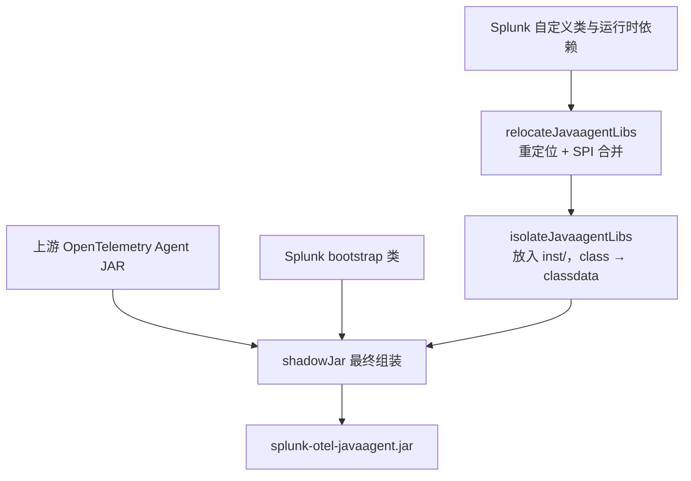
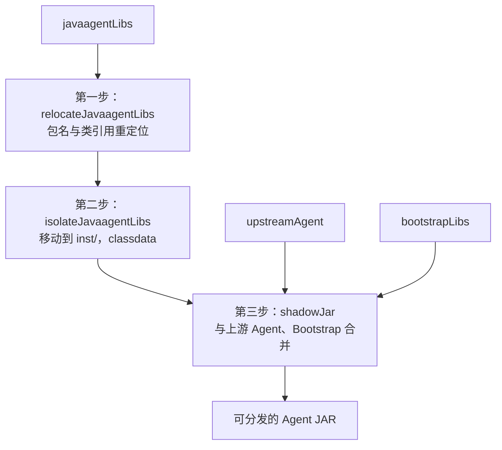

# 读懂 Splunk Java Agent：从 Gradle 工程到一个可运行的 Agent JAR

> **建议从本文开始读 R-002。** 这是一篇按实际阅读顺序编写的源码解读，不是结论清单。  
> 源码基线：[Splunk Java Agent `v2.32.0`](https://github.com/signalfx/splunk-otel-java/tree/v2.32.0)；上游 OpenTelemetry Java Instrumentation `v2.32.0`。  
> 接着读 [Shadow 约定插件逐条源码分析](shadow-conventions-source-walkthrough.md)，了解 relocation 与 SPI 合并。要查询更完整的 Gradle 规则和发布机制，再看 [`build.gradle.kts` 逐项精读](build-gradle-deep-dive.md)。  
> 本阶段仅研究源码，未在 Datafox 构建或运行 Agent。

## 先说答案：Splunk 是怎么做发行版的？

如果只记住一句话：

**Splunk 直接依赖官方发布的 OpenTelemetry Java Agent，再把自己的 Java 类和依赖按 ClassLoader 边界打进去，最后重新生成一个完整的 Java Agent JAR。**

它没有把 OpenTelemetry Java Instrumentation 整个仓库 Fork 过来，也没有重新实现 SDK。

这件事可以分成三个问题：

1. **哪些代码要打进去？** Gradle 的 `upstreamAgent`、`bootstrapLibs`、`javaagentLibs` 三种依赖配置负责区分。
2. **这些代码应该放在 JAR 的哪里？** Shadow 的 `relocateJavaagentLibs` → `isolateJavaagentLibs` → `shadowJar` 三个任务负责处理。
3. **最后由谁启动？** Manifest 指向 Splunk 的一个很薄的入口类，它最终调用官方 `OpenTelemetryAgent`。

先看整条路径：



这张图贯穿全文。下面不是逐个罗列 Gradle API，而是沿着**从工程源码到一个 JAR**的过程读。

## 第一站：先找到真正负责打包的文件

第一次打开 [Splunk 仓库](https://github.com/signalfx/splunk-otel-java/tree/v2.32.0)，容易看到很多 `build.gradle.kts`，不知道先看哪个。

实际上，按这个顺序阅读就可以：

| 阅读顺序 | 文件 | 回答的问题 |
|---|---|---|
| ① | [`settings.gradle.kts`](https://github.com/signalfx/splunk-otel-java/blob/v2.32.0/settings.gradle.kts) | 这个 Gradle 工程有哪些模块？ |
| ② | [根 `build.gradle.kts`](https://github.com/signalfx/splunk-otel-java/blob/v2.32.0/build.gradle.kts) | 版本、发布、通用规则在哪里设置？ |
| ③ | [`dependencyManagement/build.gradle.kts`](https://github.com/signalfx/splunk-otel-java/blob/v2.32.0/dependencyManagement/build.gradle.kts) | SDK、Agent 和其他依赖版本谁来管？ |
| ④ | [`agent/build.gradle.kts`](https://github.com/signalfx/splunk-otel-java/blob/v2.32.0/agent/build.gradle.kts) | 真正的 Agent JAR 是怎样构建出来的？ |
| ⑤ | [`splunk.shadow-conventions.gradle.kts`](https://github.com/signalfx/splunk-otel-java/blob/v2.32.0/buildSrc/src/main/kotlin/splunk.shadow-conventions.gradle.kts) | 重定位与 ServiceLoader 为什么这样处理？ |

这里先澄清两个容易混淆的概念：

- `settings.gradle.kts` 里的 `include("profiler")` 只表示 **Profiler 是参与 Gradle 构建的子项目**。
- `agent/build.gradle.kts` 里的 `javaagentLibs(project(":profiler"))` 才表示 **Profiler 的运行时内容会进入最终 Agent**。

**项目模块结构**和**Agent JAR 内的类加载结构**，不是一回事。

## 第二站：根 `build.gradle.kts` 为什么这么短？

根脚本的核心可以概括为：

```kotlin
plugins {
  id("idea")
  id("io.github.gradle-nexus.publish-plugin")
}

apply(from = "version.gradle.kts")

group = "com.splunk"

subprojects {
  version = rootProject.version
  if (this.name != "dependencyManagement") {
    apply(plugin = "splunk.java-conventions")
    apply(plugin = "splunk.spotless-conventions")
  }
}
```

*这是主体结构节选。原文件还有 Sonatype 发布仓库和 CI 依赖缓存配置。*

读这段代码时，可以把它理解成：**“整个工程使用什么规则”，而不是“Agent 要怎么打包”。**

`apply(from = "version.gradle.kts")` 读入 Splunk 自己的发行版版本。固定源码中：

```kotlin
val distroVersion = "2.32.0"

allprojects {
  version = distroVersion
}
```

`subprojects` 给普通 Java 模块应用 Java 与格式约定；跳过 `dependencyManagement`，是因为后者本质上是依赖版本平台，不是普通的 Java 代码模块。

真正执行 ClassLoader 隔离和 JAR 组装的代码**不在根脚本**。这使根构建维持较少的职责。

**对 Datafox 的启示**：根构建同样只维护公共规则，不应把 Shadow 的所有任务和产品业务逻辑都塞到根目录。

## 第三站：为什么还需要 `dependencyManagement`？

Splunk 的 `:custom`、`:profiler`、`:opamp` 和大量 Instrumentation 都依赖 OpenTelemetry 或第三方库。若每个模块各写一套版本，就容易产生同一 Agent 内依赖版本不一致的问题。

于是 Splunk 做了一个单独的 Gradle Platform：

```kotlin
plugins {
  `java-platform`
}

javaPlatform {
  allowDependencies()
}
```

在 [`dependencyManagement/build.gradle.kts`](https://github.com/signalfx/splunk-otel-java/blob/v2.32.0/dependencyManagement/build.gradle.kts) 中定义 BOM 和版本约束，部分示例：

```kotlin
api(enforcedPlatform(
  "io.opentelemetry:opentelemetry-bom-alpha:$otelAlphaVersion"
))

api(enforcedPlatform(
  "io.opentelemetry.instrumentation:opentelemetry-instrumentation-bom-alpha:$otelInstrumentationAlphaVersion"
))
```

可以分三层理解：

- **BOM**：集中表达同一生态中多个 Artifact 的兼容版本。
- **`constraints`**：补充某个独立依赖的版本约束，例如第三方日志或测试依赖。
- **`enforcedPlatform`**：采用强制约束，影响依赖冲突时的版本选择；这是 Splunk 的工程策略，不是 Gradle 或 OpenTelemetry 对所有发行版的硬性要求。

还有一点很重要：**发行版自己的版本与上游依赖版本要分开理解。**

在这个源码版本中，Splunk 发行版是 `2.32.0`，Instrumentation 是 `2.32.0`，SDK 是 `1.66.0`。它们是不同项目的版本号，不能因为当前看起来相同就混成一个 `version`。

Splunk 通过 `splunk.java-conventions` 将版本平台应用到需要解析依赖的配置，同时在 `:agent` 对 `upstreamAgent` 显式添加 Platform。原因是：**自定义的 Gradle Configuration 不一定自动获得普通 Java Configuration 的依赖约束**。

对 Datafox 而言，应先把上游 SDK/Agent 版本统一管理；是否立即设立完整的 `java-platform`，取决于真实的多模块依赖复杂度。

## 第四站：`agent/build.gradle.kts` 才是关键

来到 [`agent/build.gradle.kts`](https://github.com/signalfx/splunk-otel-java/blob/v2.32.0/agent/build.gradle.kts)，首先不是看 Shadow，而是看三个 Configuration。

```kotlin
val bootstrapLibs = configurations.create("bootstrapLibs") {
  isCanBeResolved = true
  isCanBeConsumed = false
}

val javaagentLibs = configurations.create("javaagentLibs") {
  isCanBeResolved = true
  isCanBeConsumed = false
}

val upstreamAgent = configurations.create("upstreamAgent") {
  isCanBeResolved = true
  isCanBeConsumed = false
}
```

这段配置的 `isCanBeResolved = true` 表示 Gradle 可以解析依赖文件；`isCanBeConsumed = false` 表示它们不作为对外发布的 Gradle 变体。

**它们本身不是 ClassLoader。** 它们只是告诉后面的打包任务：这一组依赖该按哪种方式放进 Agent。

然后看具体依赖：

```kotlin
dependencies {
  bootstrapLibs(project(":bootstrap"))

  javaagentLibs(project(":custom"))
  javaagentLibs(project(":opamp"))
  javaagentLibs(project(":profiler"))

  upstreamAgent(
    "io.opentelemetry.javaagent:opentelemetry-javaagent"
  )
}
```

为什么不统一用 `implementation`？

因为**放错位置就可能由错误的 ClassLoader 加载**。例如：

| 依赖 | 应该处在何处 | 为什么 |
|---|---|---|
| 上游 Agent | 保留官方既有封装 | 官方已经完成内部隔离，不需要再做一次 |
| Splunk Bootstrap 类 | Bootstrap 可见区域 | 需要能被 Agent 和部分注入应用的 Helper 引用 |
| Splunk 自定义 SDK/Instrumentation 等类 | AgentClassLoader 的 `inst/` | 与受监控应用的依赖隔离 |

所以 Splunk 单独给 `javaagentLibs` 设计 relocation 和 isolation 流水线。

### 一个容易忽略的细节：Instrumentation 怎么进入 JAR？

Splunk 不逐个手写所有 `:instrumentation:jdbc`、`:instrumentation:tomcat` 等依赖。它遍历 Instrumentation 子项目，判断是否应用 `splunk.instrumentation-conventions`，若应用就将其加入 `javaagentLibs`。

这叫**约定驱动的聚合**，适合几十个 Instrumentation 的工程。

Datafox 起步时可以先使用：

```kotlin
javaagentLibs(project(":custom"))
// 确实有专有 Instrumentation 再添加对应项目
```

不必为了自动化而让依赖来源变得隐蔽。

## 第五站：Shadow 为什么不是直接打一个 Fat JAR？

这是理解整个 Splunk 架构最关键的地方。

**普通 Fat JAR 的直觉**是：把依赖里的 `.class` 文件直接合并到一个 JAR 里。

但 OpenTelemetry Agent 有额外要求：

- Bootstrap 必须能访问部分基础类；
- Agent 自己的实现需要与 Application ClassLoader 隔离；
- 自定义库引用的 OpenTelemetry 类必须指向 Agent 内正确的 shaded 名称；
- 多个 JAR 注册同一个 SPI 时，服务提供者不能丢失。

因此 Splunk 不是一次 `shadowJar` 完成全部工作，而是分三步。



### 第一步：`relocateJavaagentLibs`——解决“引用的是谁”

核心配置：

```kotlin
val relocateJavaagentLibs =
  register<ShadowJar>("relocateJavaagentLibs") {
    configurations = listOf(javaagentLibs)
    duplicatesStrategy = DuplicatesStrategy.FAIL
    archiveFileName.set("javaagentLibs-relocated.jar")
  }
```

这里真正的 `relocate(...)` 规则来自 [`splunk.shadow-conventions.gradle.kts`](https://github.com/signalfx/splunk-otel-java/blob/v2.32.0/buildSrc/src/main/kotlin/splunk.shadow-conventions.gradle.kts)。

例如它将：

```text
io.opentelemetry.api
    ↓
io.opentelemetry.javaagent.shaded.io.opentelemetry.api
```

为什么这样做？

因为应用自己可能也带了一份 `io.opentelemetry.api`，而 Agent 内部使用的是隔离过的 API。Splunk 编译时引用的 API，打包后要按上游 Agent 的命名空间访问，而不是无意间碰到应用类路径上的那一份。

同一插件还处理 `context`、`common`、`semconv`、`io.opentelemetry.instrumentation`；对 `org.slf4j` 和 `java.util.logging.Logger` 还有特定规则。

**这里不能简单写一条“重定位所有 `io.opentelemetry.*`”**。有些 Resource Provider 等包必须保留在其预期的 ClassLoader 位置；真正的规则还包括排除项。

第一阶段还会排除已由上游 Bootstrap 提供的 API、Context、Common 等依赖，避免把传递依赖重复装进 Agent。

### 第二步：`isolateJavaagentLibs`——解决“类存在哪里”

第一阶段得到的是一个重定位后的 JAR，但此时里面还是普通的类文件。

Splunk 接着执行：

```kotlin
val isolateJavaagentLibs =
  register<Copy>("isolateJavaagentLibs") {
    dependsOn(relocateJavaagentLibs)
    isolateClasses(relocateJavaagentLibs.get().outputs.files)
    into(layout.buildDirectory.dir("isolated/javaagentLibs"))
  }
```

`isolateClasses()` 的关键处理是：

```text
打包前：com/splunk/example/SomeClass.class
打包后：inst/com/splunk/example/SomeClass.classdata
```

注意：**`.classdata` 不是新字节码格式**。只是把类资源放在上游 AgentClassLoader 识别的特殊目录并改变扩展名。JVM 应用自己的普通 ClassLoader 不会像读取普通依赖那样读取这些 Agent 内部资源。

Splunk 为什么不把这一步直接放在最终 Shadow 任务里？

源码注释给出的理由是 **CopySpec 的重复资源策略不完全由外层 `shadowJar` 统一控制**。独立生成 `isolated/javaagentLibs`，可以更明确地区分“自定义库之间的重复”与“自定义库和上游 Agent 之间的重复”。

### 第三步：`shadowJar`——解决“如何组装成最终 Agent”

最后一个任务：

```kotlin
shadowJar {
  configurations = listOf(bootstrapLibs, upstreamAgent)
  dependsOn(isolateJavaagentLibs)
  from(isolateJavaagentLibs.get().outputs)

  archiveClassifier.set("all")
  duplicatesStrategy = DuplicatesStrategy.EXCLUDE

  mergeServiceFiles("inst/META-INF/services")
}
```

这一步并不是把 `javaagentLibs` 的原始依赖再装一遍，而是把**已经隔离的产物**和上游 Agent、Bootstrap 合并。

如果把第一、二步省掉，直接把 `javaagentLibs` 加到最终 Shadow 的普通根目录，得不到与上游 Distro 相同的结构。

### 为什么两处都要合并 `META-INF/services`？

假设两个模块都提供 `io.opentelemetry.sdk.autoconfigure.spi.AutoConfigurationCustomizerProvider`。它们会各自包含同名的：

```text
META-INF/services/io.opentelemetry.sdk.autoconfigure.spi.AutoConfigurationCustomizerProvider
```

内容是各自的实现类名。

如果普通的“同名文件只留第一个”规则先运行，另一个实现就可能不再被 `ServiceLoader` 发现。

所以 Splunk 在 relocation 阶段调用 `mergeServiceFiles()`，并允许 `META-INF/services/**` 这个范围的重复输入。隔离之后，文件位置进入 `inst/META-INF/services/`；最终组装时再次对这个位置合并。

这里的**两次合并面向不同阶段**：

- 第一次：来自多个新增 Agent 依赖的服务注册。
- 第二次：新增内容和上游 Agent 已有 `inst/` 服务文件的合并。

这也是为什么 `duplicatesStrategy = EXCLUDE` 不能替代 SPI 合并。

想核对每条 relocation 的作用、SPI 合并、签名过滤和依赖排除，接着阅读 [Shadow 约定插件逐条源码分析](shadow-conventions-source-walkthrough.md)。

## 第六站：打包完后，JVM 到底启动哪个类？

看 Manifest 才能回答。

Splunk v2.32.0 的 `agent/build.gradle.kts` 定义：

| 属性 | Splunk 的值 | 实际用途 |
|---|---|---|
| `Main-Class` | `io.opentelemetry.javaagent.OpenTelemetryAgent` | JAR 主入口 |
| `Premain-Class` | `com.splunk.opentelemetry.javaagent.SplunkAgent` | 使用 `-javaagent` 启动 |
| `Agent-Class` | `com.splunk.opentelemetry.javaagent.SplunkAgent` | Java Agent Attach |
| `Can-Retransform-Classes` | `true` | 声明支持重新转换类 |
| `Can-Redefine-Classes` | `true` | 声明支持重新定义类 |

既然 Splunk 的 `Premain-Class` 指向自己，是否意味着它重写了 Agent 启动机制？

并没有。[SplunkAgent.java](https://github.com/signalfx/splunk-otel-java/blob/v2.32.0/bootstrap/src/main/java/com/splunk/opentelemetry/javaagent/SplunkAgent.java) 核心只有：

```java
public static void premain(String agentArgs, Instrumentation inst) {
  agentmain(agentArgs, inst);
}

public static void agentmain(String agentArgs, Instrumentation inst) {
  OpenTelemetryAgent.agentmain(agentArgs, inst);
}
```

**Splunk 增加的是一层薄委托，并没有重新创建 SDK、Byte Buddy 或 OpenTelemetry 的初始化生命周期。**

因此 Datafox 即使完全参考 Splunk 的 Gradle 工程，也不必自动复制这层入口；只有明确需要启动前动作时才值得增加。

## 第七站：为什么还要有一个 `mainShadowJar`？

此时 `shadowJar` 生成的产物带 `all` classifier，例如：

```text
splunk-otel-javaagent-2.32.0-all.jar
```

Splunk 还注册了 `mainShadowJar`，把这个 JAR 的内容和 Manifest 复制成**无 classifier 的主制品**，供 Maven Publication 使用。

要把这三个概念拆开：

- **`shadowJar`**：负责运行时结构正确的 Agent。
- **`mainShadowJar`**：适配 Maven 主 Artifact 的文件/分类约定。
- **`publishing`、`signing`**：负责 POM、Sources/Javadoc、Sonatype、GPG 等交付流程。

Splunk 额外处理许可证报告，并在发布脚本中生成 SHA-256、GitHub Draft Release 和部分其他产品制品。它们不是 ClassLoader 隔离所必需的步骤。

如果 Datafox 初期只需要在 GitHub Release 提供一个 `-javaagent` JAR，就先完成核心 Shadow 流水线，不必同步复制两个 JAR 产物、Sonatype 和签名流程。

## 最后，把这些结论映射到 Datafox

现在我们已经从 `settings.gradle.kts` 一直读到了最后一个 JAR。与其复制整个 Splunk 仓库，不如逐项决定需要哪个工程机制。

| Splunk 的做法 | Datafox 目前的处理 | 判断理由 |
|---|---|---|
| `upstreamAgent` 引入官方 Agent | **采用** | 不 Fork，上游升级面小 |
| `bootstrapLibs` / `javaagentLibs` 分层 | **采用打包边界** | 直接对应 Agent 的类加载结构 |
| Shadow relocation → isolation → final JAR | **采用** | 这是单 JAR 发行版的关键封装机制 |
| 发行版与 SDK/Instrumentation 版本分开 | **采用** | 版本生命周期不同 |
| `buildSrc` 全套约定插件 | **按需提取** | 只有公共构建规则值得复用时才引入 |
| `dependencyManagement` 全量强制平台 | **按需设计** | 初期可能不需要大量 BOM / constraints |
| `SplunkAgent` 品牌启动入口 | **暂不采用** | 无真实的启动前逻辑 |
| 自动发现所有 Instrumentation Project | **暂不采用** | 显式依赖更容易审查 |
| OpAMP、Profiler、No-code、商用应用服务器埋点 | **不照搬** | 属于 Splunk 的实际产品范围 |
| Maven/GPG/第二份无 classifier JAR | **交付需求确定后再加** | 与 ClassLoader 正确性无关 |

从 Splunk 学到的不是“多建几个模块”，而是**将构建依赖与类加载位置建立明确映射**：

- **谁需要 Bootstrap 可见？** 放入 `bootstrapLibs`。
- **谁需要 AgentClassLoader 隔离？** 放入 `javaagentLibs`。
- **谁已经由官方 Agent 提供？** 留在 `upstreamAgent` 或按 `compileOnly` 引用，不重复实现。
- **谁只是 Splunk 产品特有功能？** Datafox 没有需求就不引入。

这样才能既优先参考 Splunk 的工程结构和 Gradle 打包，又保持发行版足够薄。

## 继续读什么？

阅读完本文，应该已经能解释 Splunk 为什么需要三种 Configuration、三个 Shadow 任务，以及为什么最终 JAR 不是普通 Fat JAR。

若要着手编写 Datafox Gradle，可按下面的顺序使用现有证据：

1. [Shadow 约定插件逐条源码分析](shadow-conventions-source-walkthrough.md)——核对所有 relocation、ServiceLoader 规则、资源过滤及依赖排除的作用。
2. [深入版：`build.gradle.kts` 逐项源码精读](build-gradle-deep-dive.md)——理解整个 Gradle 构建体系和发行物组织。
3. [运行时定制机制](runtime-customizations.md)——理解 `:custom`、OpAMP、Profiler、Instrumentation 各自何时接入。
4. [Datafox Gradle 工程设计草案](../../../../design-docs/datafox-gradle-distribution.md)——将确定的打包契约转为最小工程模块，不提前复制 Splunk 的全部功能。

**证据边界**：此文的代码示例来自固定版本源码，少量代码为删去无关项的节选；上面写的 Datafox“采用／不采用”属于当前设计方向，不是已执行的构建结果。按照项目要求，本阶段不进行独立 Agent 原型验证。
