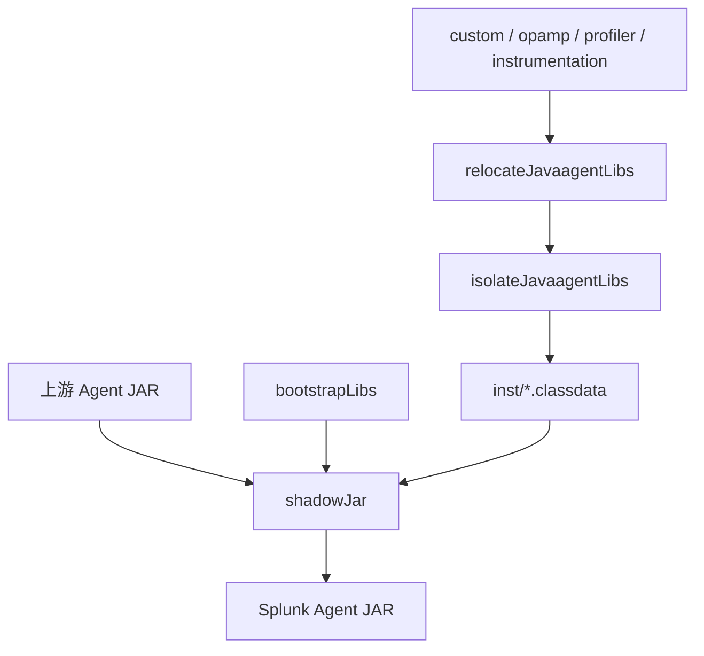

# Splunk Java Agent 发行版架构与 Gradle 构建

研究编号：R-002；轮次：RR-001；研究日期：2026-10-23；源码基线：[`signalfx/splunk-otel-java@v2.32.0`](https://github.com/signalfx/splunk-otel-java/tree/v2.32.0)。此文是源码取证，不代表在 Datafox 执行了构建或运行。

## 1. 总体结构：基于上游二次打包，不 Fork SDK

[Splunk settings.gradle.kts](https://github.com/signalfx/splunk-otel-java/blob/v2.32.0/settings.gradle.kts) 使用 Gradle Kotlin DSL 多模块构建。主要模块按运行时职责分组：

| 模块 | 作用 | 证据 |
|---|---|---|
| `:agent` | 引入发布的上游 Agent、整合自定义库、打包和发布 | [agent/build.gradle.kts](https://github.com/signalfx/splunk-otel-java/blob/v2.32.0/agent/build.gradle.kts) |
| `:bootstrap` | SplunkAgent 启动入口和 Bootstrap 可见辅助类 | [bootstrap/build.gradle.kts](https://github.com/signalfx/splunk-otel-java/blob/v2.32.0/bootstrap/build.gradle.kts) |
| `:custom` | SDK 自动配置、Resource、Sampler、校验、服务名、日志等 | [custom/build.gradle.kts](https://github.com/signalfx/splunk-otel-java/blob/v2.32.0/custom/build.gradle.kts) |
| `:instrumentation:*` | JDBC、Tomcat、Jetty、WebLogic、Liberty、WebSphere、No-code 等专有 Instrumentation | [settings.gradle.kts](https://github.com/signalfx/splunk-otel-java/blob/v2.32.0/settings.gradle.kts) |
| `:opamp` | OpAMP 客户端、有效配置上报、远程配置 | [opamp/build.gradle.kts](https://github.com/signalfx/splunk-otel-java/blob/v2.32.0/opamp/build.gradle.kts) |
| `:profiler` | JFR、CPU/内存剖析、Snapshot Profiling | [profiler/build.gradle.kts](https://github.com/signalfx/splunk-otel-java/blob/v2.32.0/profiler/build.gradle.kts) |
| `:dependencyManagement` | SDK、Instrumentation、Contrib、测试等依赖版本约束 | [dependencyManagement/build.gradle.kts](https://github.com/signalfx/splunk-otel-java/blob/v2.32.0/dependencyManagement/build.gradle.kts) |
| `:smoke-tests`、`:testing:*`、`:matrix` | 发行包、Instrumentation 和目标容器兼容性测试 | [smoke-tests/build.gradle.kts](https://github.com/signalfx/splunk-otel-java/blob/v2.32.0/smoke-tests/build.gradle.kts) |
| `:agent-csa-bundle` | Cisco Secure Application 额外发行包（实验性） | [agent-csa-bundle/README.md](https://github.com/signalfx/splunk-otel-java/blob/v2.32.0/agent-csa-bundle/README.md) |

Splunk 的模块较多是因为实际包含 Profiling、远程配置、专有应用服务器支持等产品功能；不能将其模块数量当作 Datafox 的起步要求。

## 2. Gradle 的统一依赖管理

[dependencyManagement/build.gradle.kts](https://github.com/signalfx/splunk-otel-java/blob/v2.32.0/dependencyManagement/build.gradle.kts) 使用 `java-platform`，结合 BOM 和 constraints 固定依赖版本，并通过 [splunk.java-conventions](https://github.com/signalfx/splunk-otel-java/blob/v2.32.0/buildSrc/src/main/kotlin/splunk.java-conventions.gradle.kts) 应用于各子项目。

`v2.32.0` 源码中的主要版本：

- Splunk Distro `2.32.0`，OpenTelemetry Instrumentation `2.32.0`，SDK `1.66.0`。
- Gradle Wrapper `9.8.1`；Shadow `9.6.1`。
- GitHub CI 使用 JDK 25 **运行 Gradle**；`:bootstrap`、`:custom` 和若干 Instrumentation 的 Java 编译目标是 Java 8。这是不同维度。
- 根项目通过 `version.gradle.kts` 设置发行版版本，`dependencyManagement` 单独控制上游 SDK 与 Instrumentation 版本；两者虽然此版本号相同，但概念上独立。

Splunk 的 BOM 包括 `opentelemetry-bom-alpha`、`opentelemetry-instrumentation-bom-alpha`、JUnit、Jackson、Protobuf、Testcontainers 等，并使用 `enforcedPlatform`；Datafox 应理解它服务于 Splunk 多模块依赖收敛，不能未经需求评估就复制所有强制约束。

## 3. Agent 的三阶段打包

[agent/build.gradle.kts](https://github.com/signalfx/splunk-otel-java/blob/v2.32.0/agent/build.gradle.kts) 直接沿用官方 Distro 的三个 Gradle Configuration：

```kotlin
bootstrapLibs(project(":bootstrap"))
javaagentLibs(project(":custom"))
javaagentLibs(project(":opamp"))
javaagentLibs(project(":profiler"))
upstreamAgent("io.opentelemetry.javaagent:opentelemetry-javaagent")
```

同时，`:agent` 监听 `:instrumentation` 子项目是否应用 `splunk.instrumentation-conventions`，将符合条件的子项目动态加入 `javaagentLibs`，避免在 Agent 脚本中逐个硬编码。



三个阶段：

1. `relocateJavaagentLibs`：由 [splunk.shadow-conventions](https://github.com/signalfx/splunk-otel-java/blob/v2.32.0/buildSrc/src/main/kotlin/splunk.shadow-conventions.gradle.kts) 完成 ServiceLoader 合并、OpenTelemetry API/Instrumentation 重定位、SLF4J 和 JUL 特殊处理；排除上游 Bootstrap 已提供的 API 依赖。
2. `isolateJavaagentLibs`：将新增 Agent 类复制到 `inst/`，重命名为 `.classdata`，排除签名等不应重复打包的资源。
3. `shadowJar`：合并 `bootstrapLibs`、上游 Agent、隔离后的自定义库和 `inst/META-INF/services`，生成带发行版 Manifest 的 JAR。

这属于**内部 Agent 类打包**，不是将一个独立 Extension JAR 放进 `extensions/`。Splunk 的 `agent-csa-bundle` 另有专门的实验性捆绑路线，不能与主发行版混淆。

## 4. SplunkAgent 的真实作用

Splunk 与官方 Demo 的一个显著差异是 Manifest：

| Manifest 字段 | Splunk |
|---|---|
| `Main-Class` | `io.opentelemetry.javaagent.OpenTelemetryAgent` |
| `Agent-Class` | `com.splunk.opentelemetry.javaagent.SplunkAgent` |
| `Premain-Class` | `com.splunk.opentelemetry.javaagent.SplunkAgent` |

[SplunkAgent.java](https://github.com/signalfx/splunk-otel-java/blob/v2.32.0/bootstrap/src/main/java/com/splunk/opentelemetry/javaagent/SplunkAgent.java) 的 `premain` 调用自身 `agentmain`，再调用 `OpenTelemetryAgent.agentmain(agentArgs, inst)`。**这是薄启动委托，不是重新实现 OpenTelemetry 的 Agent 初始化器。**

对 Datafox 的判断：若没有确切的启动前逻辑需求，沿用官方 `OpenTelemetryAgent` 作为入口更简单。Splunk 的品牌入口不是所有发行版的必要条件。

## 5. 发行物和发布

Splunk 的 `:agent` 生成 `shadowJar`（`all` classifier）与 `mainShadowJar`（无 classifier），后者用于 Maven Central 的主制品；发布插件设置 `com.splunk:splunk-otel-javaagent`、POM、源码/Javadoc、GPG 签名，许可证报告随发行物管理。

[release.sh](https://github.com/signalfx/splunk-otel-java/blob/v2.32.0/scripts/release.sh) 通过 Gradle `assemble`、Metadata 生成、Sonatype 发布，生成签名、SHA-256 校验和、GitHub Draft Release。它还生成 Cloud Foundry Buildpack，并发布额外 CSA Bundle。

[Dockerfile-ghcr](https://github.com/signalfx/splunk-otel-java/blob/v2.32.0/Dockerfile-ghcr) 基于 BusyBox 下载发行版 JAR，提供 `/javaagent.jar` 符号链接以支持 OpenTelemetry Operator 的自动注入约定。

对 Datafox：保留可复现的单 JAR 发行与版本元数据思路；Maven 签名、Docker、Cloud Foundry、CSA Bundle 应根据交付需求独立决定。

## 6. 对 Datafox 的架构启示

**可以直接参考**：官方 Agent 依赖、`bootstrapLibs`/`javaagentLibs`/`upstreamAgent` 分层、Shadow 三阶段打包、发行物 Manifest、统一上游版本和按实际功能划分模块。

**不应直接复制**：全部 Instrumentation、Profiler、OpAMP、CSA、内部 Tooling 依赖、复杂 `buildSrc`、许可证与发布平台集成。

**特别注意**：Splunk 的启动入口、自动收集 Instrumentation 子项目和内部 Tooling 使用都是具体工程选择，不属于 OpenTelemetry 的强制发行版契约。对 Datafox 的最终设计应继续坚持“有真实需求才增加模块与抽象”。

## 源码取证边界

本次未在 Datafox 或 Splunk 执行 Gradle、JAR 解包、`-javaagent` 或性能测试。所有结论来自固定标签的构建脚本、源码及发行文档。对运行时行为的判断以源码可见的调用关系为限。
