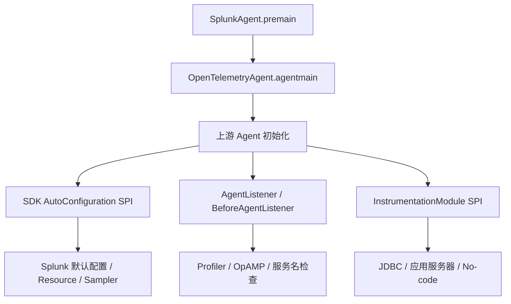

# Splunk 发行版专有能力与运行时接入机制

研究编号：R-002；基线：`signalfx/splunk-otel-java@v2.32.0`；本记录只分析源码与文档，不执行运行验证。

## 1. Splunk 的自定义逻辑如何进入 Agent

Splunk 主发行版将 `:custom`、`:opamp`、`:profiler` 和特定 `:instrumentation:*` 的 Java 类放进 AgentClassLoader 的 `inst/` 区域。模块实现仍使用官方 SDK SPI、Java Agent SPI 或少量内部 Tooling SPI；打包形式不是外部 `otel.javaagent.extensions` JAR。

[SplunkAgent.java](https://github.com/signalfx/splunk-otel-java/blob/v2.32.0/bootstrap/src/main/java/com/splunk/opentelemetry/javaagent/SplunkAgent.java) 仅委托给上游 Agent；多数差异通过 ServiceLoader 发现。若新增 Datafox 功能可直接复用上游 SPI，就不应复制 Splunk 的内部初始化逻辑。

## 2. `:custom`：默认配置和 SDK 定制

[SplunkConfigurationCustomizer](https://github.com/signalfx/splunk-otel-java/blob/v2.32.0/custom/src/main/java/com/splunk/opentelemetry/SplunkConfigurationCustomizer.java) 使用 `@AutoService(AutoConfigurationCustomizerProvider.class)`，调用：

- `addPropertiesSupplier`：提供 `otel.traces.sampler=always_on`、Spring Batch 埋点开关等默认值。
- `addPropertiesCustomizer`：根据 `splunk.realm` 生成 Splunk Ingest OTLP 地址；根据 `splunk.access.token` 添加 OTLP 请求头；未配置日志 Exporter 时关闭对应日志 Instrumentation；通过 `EndpointProtocolValidator` 对端口/协议组合输出警告。
- `addIfAbsent` 在配置值不存在时才写入部分 OTLP 默认值。注意 Token Header 的组合和日志埋点关闭是显式的定制逻辑，不能概括成“Splunk 绝不覆盖任何配置”。

[SplunkTracerProviderConfigurer](https://github.com/signalfx/splunk-otel-java/blob/v2.32.0/custom/src/main/java/com/splunk/opentelemetry/SplunkTracerProviderConfigurer.java) 使用 `addTracerProviderCustomizer` 调整 SpanLimits：属性、事件等数量采用 `Integer.MAX_VALUE`，Link 数量上限 1000，属性值长度上限 12000。该行为是 Splunk 产品选择，**不是 OpenTelemetry SDK 默认值，也不应照搬到 Datafox**。

[SplunkDistroVersionResourceProvider](https://github.com/signalfx/splunk-otel-java/blob/v2.32.0/custom/src/main/java/com/splunk/opentelemetry/resource/SplunkDistroVersionResourceProvider.java) 提供 `telemetry.distro.version` 等发行版标识，并设置较高 `order()`；`custom/build.gradle.kts` 在构建时生成 `splunk.properties`。这是区分上游与发行版版本的直接实现。

## 3. 服务名检查与内部 API 边界

[ServiceNameChecker](https://github.com/signalfx/splunk-otel-java/blob/v2.32.0/custom/src/main/java/com/splunk/opentelemetry/servicename/ServiceNameChecker.java) 实现 `BeforeAgentListener`，在初始化阶段检查 `service.name`，未设置时警告，而不是默默覆盖用户服务名。

此类依赖 `io.opentelemetry.javaagent.tooling.BeforeAgentListener`，并通过 `AutoConfigureUtil` 读取配置和 Resource。仓库还包含 [`io.opentelemetry.sdk.autoconfigure.AutoConfigureUtil`](https://github.com/signalfx/splunk-otel-java/blob/v2.32.0/custom/src/main/java/io/opentelemetry/sdk/autoconfigure/AutoConfigureUtil.java) 辅助类。

**架构风险**：`BeforeAgentListener` 和 `javaagent-tooling` 属于上游内部机制，维护成本高于公开稳定 SPI。Splunk 已接受这种差异，但 Datafox 不应将其当作默认方案。

## 4. OpAMP：独立能力模块

[OpampActivator](https://github.com/signalfx/splunk-otel-java/blob/v2.32.0/opamp/src/main/java/com/splunk/opentelemetry/opamp/OpampActivator.java) 实现 `AgentListener`，在 Agent 初始化后读取配置。禁用时立即返回；启用时创建 OpAMP 客户端，报告 Agent 身份、健康状态和有效配置，并处理服务端消息及远程配置。

[OpampClientConfigurationFactory](https://github.com/signalfx/splunk-otel-java/blob/v2.32.0/opamp/src/main/java/com/splunk/opentelemetry/opamp/OpampClientConfigurationFactory.java) 同时读取传统 `splunk.opamp.*` 属性和声明式配置中的 `opamp/development`。后者借助 [DeclarativeConfigurationInterceptor](https://github.com/signalfx/splunk-otel-java/blob/v2.32.0/opamp/src/main/java/com/splunk/opentelemetry/opamp/DeclarativeConfigurationInterceptor.java) 获取配置模型。

可见生命周期：`afterAgent` → 检查 enabled → 创建 Client/回调 → 处理远程消息；实现中还显式注册 Shutdown Hook 关闭 Client。对 Datafox 而言，这种线程与生命周期成本只有在确实需要 Agent 远程管理时才值得引入。

## 5. Profiler：独立能力模块

[ProfilerAgentListener](https://github.com/signalfx/splunk-otel-java/blob/v2.32.0/profiler/src/main/java/com/splunk/opentelemetry/profiler/ProfilerAgentListener.java) 同时实现 `BeforeAgentListener` 和 `AgentListener`：初始化前配置 JFR ContextStorage，初始化后创建 Supervisor；若 Profiler 未启用则返回；需要 JFR 但 JVM 不支持时记录警告。

`:profiler` 还包含 JFR Recording、CPU/内存事件、Pprof 导出、Span 关联和 Snapshot Profiling。它的模块隔离来自实际能力边界和大量独立依赖，**不是所有发行版都需要 Profiler**。

## 6. Instrumentation：复用上游、补充差异

Splunk 的 `:instrumentation:jdbc`、`:instrumentation:tomcat`、`:instrumentation:weblogic` 等模块基于 `InstrumentationModule`、`TypeInstrumentation`、Byte Buddy Advice 及上游 Instrumentation API 实现特定场景；并非把所有上游埋点重新写一遍。

[Instrumentation 约定](https://github.com/signalfx/splunk-otel-java/blob/v2.32.0/buildSrc/src/main/kotlin/splunk.instrumentation-testing-conventions.gradle.kts) 为测试提供 `-javaagent`、额外 Instrumentation 初始化 JAR、`testLatestDeps`、`library` / `testLibrary` 配置等；[Muzzle 约定](https://github.com/signalfx/splunk-otel-java/blob/v2.32.0/buildSrc/src/main/kotlin/splunk.muzzle-conventions.gradle.kts) 将 Muzzle 插件单独按需应用，源码注释说明有些模块无法统一开启。

`:agent` 自动发现应用了 `splunk.instrumentation-conventions` 的子项目，并加入 `javaagentLibs`。这是避免随着模块数量增长手工维护打包依赖的工程选择；如果 Datafox 起步只有一两个 Instrumentation，直接显式声明更简单。

## 7. 对 Datafox 的取舍

**可复用上游机制**：SDK AutoConfiguration、ResourceProvider、Sampler SPI、InstrumentationModule、AgentListener（按当前版本的公开契约评估）、ClassLoader 隔离和 Gradle 打包。

**可参考 Splunk 的工程方法**：产品功能独立模块、配置默认值和显式配置分离、发行版版本属性、按需接入 Instrumentation、初始化早期禁用快速返回。

**暂不照搬**：Splunk Realm/Token、SpanLimits 放宽、OpAMP、Profiler、No-code 表达式引擎、专有应用服务器适配、内部 `BeforeAgentListener`、自定义 SDK AutoConfigureUtil、额外 Shutdown Hook。

## 8. 证据与限制

以上结论来自 `v2.32.0` 固定源码；未执行 Agent，也未测量启动耗时、内存、线程数或类加载成本。产品模块的性能、稳定性和兼容性不能仅凭代码组织推断。
