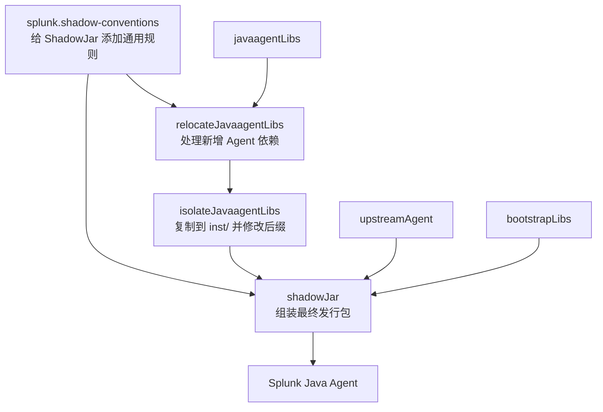

# Splunk Shadow 构建插件精读：为什么这样重定位、合并和隔离？

> **建议先读：** [从 Gradle 工程到最终 Agent JAR](gradle-and-packaging.md)。本篇在其基础上，专门精读 Splunk 的 `splunk.shadow-conventions.gradle.kts`。  
> **固定源码：** [Splunk Java Agent `v2.32.0` — `splunk.shadow-conventions.gradle.kts`](https://github.com/signalfx/splunk-otel-java/blob/v2.32.0/buildSrc/src/main/kotlin/splunk.shadow-conventions.gradle.kts)。  
> 相关代码：[Agent 组装脚本](https://github.com/signalfx/splunk-otel-java/blob/v2.32.0/agent/build.gradle.kts) · [上游 Agent 结构说明](https://github.com/open-telemetry/opentelemetry-java-instrumentation/blob/v2.32.0/docs/contributing/javaagent-structure.md)。  
> 此文是源码研究，不是 Datafox 已验证的构建记录。

## 先回答：Shadow 约定插件究竟负责什么？

Splunk 的 Agent 打包要解决两个不同的问题：

- **编译和合并：** 把自定义模块与运行时依赖打到同一个发行包里。
- **类加载正确性：** 新增的 Agent 类不能误用应用的 API，也不能被当作普通业务依赖加载；同时 SPI 提供者必须能被 Agent 发现。

`splunk.shadow-conventions.gradle.kts` 负责第二个问题里的一部分：**统一配置所有 ShadowJar 的重定位、ServiceLoader 合并与资源排除规则**。它自身并不定义最终发行包的三阶段任务；三阶段任务写在 `agent/build.gradle.kts`。



**读这两个文件时要始终分清：** `splunk.shadow-conventions.gradle.kts` 规定“所有 ShadowJar 遵守什么规则”，`agent/build.gradle.kts` 决定“有哪些任务、任务处理哪些依赖、输出放在哪里”。

## 第一步：为什么一开始就用 `tasks.withType<ShadowJar>().configureEach`？

原文件开头是：

```kotlin
import com.github.jengelman.gradle.plugins.shadow.tasks.ShadowJar

plugins {
  id("com.gradleup.shadow")
}

tasks.withType<ShadowJar>().configureEach {
  // 统一的服务合并、排除与重定位规则
}
```

这段代码表达的不是“执行一次 Shadow 打包”，而是“给本 Project 中每个 `ShadowJar` 类型的任务设置规则”。例如，`:agent` 的 `relocateJavaagentLibs` 和 `shadowJar` 都属于 `ShadowJar`，因此都会受到这些规则影响。

`configureEach` 使规则应用于已存在和后续注册的此类任务，而无需在两个任务里重复写 relocation。

**为什么 Splunk 要这样设计？** 原因是两个阶段都可能处理引用同一 API 的类，必须使用一致的 shaded 包名。将规则集中在一个插件中，可以避免一个任务更新了 relocation、另一个忘记更新。

**Datafox 的取舍：** 如果只定义两项 Shadow 任务，集中插件依旧有价值，因为规则较多且要求一致；但不必照搬 Splunk 的其他四五个 buildSrc 约定插件。

## 第二步：`mergeServiceFiles()` 到底在合并什么？

原文件紧接着配置：

```kotlin
mergeServiceFiles()

filesMatching("META-INF/services/**") {
  duplicatesStrategy = DuplicatesStrategy.INCLUDE
}
```

理解它之前，先看一个具体场景。

假设 `:custom` 和某个 Instrumentation 模块都注册同一种 ServiceLoader SPI：

```text
META-INF/services/io.opentelemetry.sdk.autoconfigure.spi.AutoConfigurationCustomizerProvider
```

两个 JAR 内的文件路径相同，但是正文可能分别是两个不同的实现类：

```text
# JAR A
com.example.agent.CustomizerA
```

```text
# JAR B
com.example.agent.CustomizerB
```

普通 JAR 合并遇到相同路径时，若仅取其中一份，便会丢失一个 SPI 提供者。**ServiceLoader 文件不是只能保留一份的普通静态资源**。

因此需要两个动作共同出现：

1. `duplicatesStrategy = INCLUDE`：允许同路径的 `META-INF/services/**` 文件进入资源合并流程。
2. `mergeServiceFiles()`：由 Shadow 的 ServiceFileTransformer 将服务提供者条目合入同一注册文件。

这也是为什么不能只把整个 JAR 的 `duplicatesStrategy` 改成 `EXCLUDE`。`EXCLUDE` 可以去掉重复文件，却不能为你合并 SPI 提供者列表。

### 为什么到最终 `shadowJar` 还要再合并一次？

请同时打开 [`agent/build.gradle.kts`](https://github.com/signalfx/splunk-otel-java/blob/v2.32.0/agent/build.gradle.kts)，你会看到：

```kotlin
shadowJar {
  // ...
  duplicatesStrategy = DuplicatesStrategy.EXCLUDE

  mergeServiceFiles("inst/META-INF/services")
  filesMatching("inst/META-INF/services/**") {
    duplicatesStrategy = DuplicatesStrategy.INCLUDE
  }
}
```

这次的路径不同：

| 阶段 | 服务文件所在位置 | 需要合并的来源 |
|---|---|---|
| `relocateJavaagentLibs` | `META-INF/services/` | 多个 Splunk 新增 Agent 依赖 |
| `isolateJavaagentLibs` | 从原位置进入 `inst/META-INF/services/` | Copy 操作改变资源所在目录 |
| 最终 `shadowJar` | `inst/META-INF/services/` | 上游 Agent 已有注册与新增 Agent 注册 |

**结论：两次合并服务于两个不同的输入集合，并不属于冗余调用。**

Datafox 应保留这套双层合并思路，只要打包了通过 ServiceLoader 发现的自定义类，就不能让合并策略丢掉注册信息。至于没有任何新增 SPI 提供者时，具体能精简多少仍应以实际产物要求为准。

## 第三步：为什么对 Kotlin 模块信息另做处理？

源码：

```kotlin
filesMatching("inst/META-INF/*.kotlin_module") {
  duplicatesStrategy = DuplicatesStrategy.INCLUDE
}
```

Splunk 注释说明：这主要是为了避免 Kotlin 模块元数据发生重复时被静默丢弃却没有警告。

这里需要区分两类文件：

- `META-INF/services/**` 是 Java SPI 注册信息，需要内容合并。
- `*.kotlin_module` 是 Kotlin 编译元数据，不是 SPI 注册信息。

**不能把 `kotlin_module` 和 `META-INF/services` 当成同一类资源，也不能因为用了 `INCLUDE` 就认为 Kotlin 元数据自动获得了语义合并。** 源码这里的 `INCLUDE` 主要在控制重复文件处理行为。

Datafox 如果仅包含 Java 源码、没有任何会在 Agent 中带入 Kotlin 元数据的依赖，可以不为假设情形增加另一套复杂 Kotlin 处理逻辑；但在参考 Splunk 全部规则时要知道这段的存在原因。

## 第四步：为什么 `module-info.class` 被排除？

```kotlin
exclude("**/module-info.class")
```

`module-info.class` 是 Java Platform Module System（JPMS）的模块描述符。Shadow 的定位是聚合并重定位多个 JAR，原模块描述符不一定能继续准确描述聚合后的结果。

Splunk 因此把匹配的 `module-info.class` 排除在 Shadow 的内容之外，避免把不适用于合并后构件的模块描述符直接保留下来。

这里不是说 Datafox 需要修改宿主应用的 JPMS；这只影响 **Shadow 正在处理的发行物资源**。也不要推断该规则会自动排除已被封装成 `.classdata` 的所有类似资源——路径与扩展名的匹配条件仍需具体判断。

## 第五步：SLF4J 为什么要单独重定位？

源码：

```kotlin
relocate(
  "org.slf4j",
  "io.opentelemetry.javaagent.slf4j"
)
```

Splunk 在注释里明确写了目的：避免与其他 SLF4J 实例发生冲突，尤其是 `premain` 的早期阶段。

为什么这一点很重要？

Agent 加载发生在业务应用初始化的非常早期。应用可能有自己的 SLF4J API、Binding 或 Provider 版本。如果发行版直接依赖相同包名，Agent 日志类与应用日志类容易因 ClassLoader 边界和版本差异而发生碰撞。

**重定位解决的是名字与引用的隔离问题，不等于自动修复日志依赖、Provider 选择或所有启动顺序问题。**

对 Datafox 的取舍：如果最终发行包确实要携带会引用 SLF4J 的自定义库，需要对照 Splunk 与上游日志隔离方式；但不能把这一行误当成“必须为 Datafox 再造一个日志框架”。

## 第六步：`Logger.getLogger` 为什么会被改写到 `PatchLogger`？

源码：

```kotlin
relocate(
  "java.util.logging.Logger",
  "io.opentelemetry.javaagent.bootstrap.PatchLogger"
)
```

这里比一般的包名 relocation 特殊：它定位的是 **JDK 中某个具体类型的引用**，而不是把一个第三方包整体搬家。

Splunk 注释是“rewrite dependencies calling Logger.getLogger”。目的在于让进入 Shadow 处理范围的 Agent 自定义代码在日志调用上使用上游 Agent 提供的 `PatchLogger` 适配类。

注意：

- **不是**把 JDK 自己的 `java.util.logging.Logger` 类移入 Agent JAR。
- **不是**替换宿主 JVM 中所有 `Logger` 对象。
- 影响范围由 Shadow 正在处理的输入字节码和重定位逻辑决定。

Datafox 不应单独复制 `PatchLogger` 类或自行实现类似全局日志重写；需要时沿用与所选官方 Agent 版本对应的规则。

## 第七步：Instrumentation API 为什么要重定位，又为什么有例外？

源码精简节选：

```kotlin
relocate(
  "io.opentelemetry.instrumentation",
  "io.opentelemetry.javaagent.shaded.instrumentation"
) {
  exclude("io.opentelemetry.instrumentation.resources.*")
  exclude("io.opentelemetry.instrumentation.spring.resources.*")
}
```

这不是随意对 OpenTelemetry 改包名。背后是一个类加载边界：

- 宿主应用本身可能依赖 **Library Instrumentation API**，使用正常包名。
- Agent 内部 Instrumentation 使用自己的 shaded API，以降低版本冲突和 ClassLoader 可见性问题。
- **资源提供者例外**：这两个 `resources` 包按照当前上游实现需要保持在 AgentClassLoader 相应位置，不应按同一条通用规则重定位。

这类例外最能说明为什么不能直接写成：

```kotlin
// 错误的泛化方式：并非 Splunk 的真实规则
relocate("io.opentelemetry", "my.agent.shaded.io.opentelemetry")
```

如果不区分 API、SDK、Instrumentation 和 Resource Provider 的运行位置，泛化重定位很容易让 SPI 或类引用不再匹配。

**Datafox 的判断**：参考 Splunk 的每一条规则和 `exclude`，同时核对当前上游 Distro 的规范；遇到新依赖先判断类加载位置，再决定是否需要添加 relocation。

## 第八步：OpenTelemetry API、Context、Common、Semconv 为什么分别列出？

源码：

```kotlin
relocate(
  "io.opentelemetry.api",
  "io.opentelemetry.javaagent.shaded.io.opentelemetry.api"
)
relocate(
  "io.opentelemetry.semconv",
  "io.opentelemetry.javaagent.shaded.io.opentelemetry.semconv"
)
relocate(
  "io.opentelemetry.context",
  "io.opentelemetry.javaagent.shaded.io.opentelemetry.context"
)
relocate(
  "io.opentelemetry.common",
  "io.opentelemetry.javaagent.shaded.io.opentelemetry.common"
)
```

可以用一个具体例子理解。假设 `:custom` 的字节码引用：

```text
io.opentelemetry.api.trace.Span
```

打包时，Shadow 需要按 Agent 的已知命名空间将引用改成：

```text
io.opentelemetry.javaagent.shaded.io.opentelemetry.api.trace.Span
```

这样新加入的类能与上游 Agent 内使用的 API 类型保持一致；否则极端情况下可能出现“名称相同但不同 ClassLoader 中类型不相等”等问题。

为什么 `api`、`context`、`common`、`semconv` 要分别列出来？因为这些是源码中明确需要处理的不同包名，而不是“凡是 OpenTelemetry 的代码全部 relocation”。例如 SDK 本体、Agent Tooling 等的类加载和打包方式不能从这四条规则直接推论。

### 重要区分：重定位类引用 ≠ 把依赖再打包一份

还要配合 `agent/build.gradle.kts` 里第一阶段的依赖排除：

```kotlin
dependencies {
  exclude(dependency("io.opentelemetry:opentelemetry-api"))
  exclude(dependency("io.opentelemetry:opentelemetry-common"))
  exclude(dependency("io.opentelemetry:opentelemetry-context"))
  // 还排除 Semconv、API incubator、SLF4J 等
}
```

**两段配置解决的是不同问题：**

| 规则 | 解决的问题 |
|---|---|
| `relocate(...)` | 新增自定义代码在运行时应引用哪个类名 |
| `dependencies { exclude(...) }` | 哪些传递依赖不该再被打到隔离后的 Agent 中 |

仅做 relocation，可能把上游已提供的 API 重复塞进发行包；仅做 exclude，新增自定义类中的引用又可能指向错误的类名。Splunk 同时处理两者。

对 Datafox，不能只复制 `splunk.shadow-conventions`，然后忽略 `agent/build.gradle.kts` 里对应的排除列表。

## 第九步：为什么还重定位 AWS X-Ray、Kotlin 扩展？

源码：

```kotlin
relocate(
  "io.opentelemetry.contrib.awsxray",
  "io.opentelemetry.javaagent.shaded.io.opentelemetry.contrib.awsxray"
)
relocate(
  "io.opentelemetry.extension.kotlin",
  "io.opentelemetry.javaagent.shaded.io.opentelemetry.extension.kotlin"
)
```

Splunk 注释说明，这些是被 Instrumentation 模块使用、可能涉及向应用 ClassLoader 注入的扩展类，因此需要与 Agent 的 shaded 名称保持一致。

**这两条的意义不是“Splunk 一定在使用全部这些扩展功能”。** 只读这一份脚本，只能确认其构建规则会处理这些包名，不能据此断言发行物一定包含相应字节码，也不能断言它们在每个业务请求路径上生效。

Datafox 如果没有相关依赖，不必凭空创建对应模块；是否保留上游兼容规则，取决于项目所选依赖及未来实际打包任务。

## 第十步：回到 `agent/build.gradle.kts`，解释这些规则如何组合生效

把前面的知识放回三阶段：

### 1. `relocateJavaagentLibs`：严格处理自定义 Agent 依赖

```kotlin
val relocateJavaagentLibs =
  register<ShadowJar>("relocateJavaagentLibs") {
    configurations = listOf(javaagentLibs)
    duplicatesStrategy = DuplicatesStrategy.FAIL
    archiveFileName.set("javaagentLibs-relocated.jar")
    // 这里还排除 Bootstrap 已提供的依赖和许可证元数据
  }
```

这里的全局策略是 `FAIL`，强调新增自定义库之间的重复资源要显式处理；通用插件对 `META-INF/services/**` 例外设为 `INCLUDE`，再做内容合并。

在这一阶段，`splunk.shadow-conventions` 的所有适用重定位规则对 Shadow 输入执行处理。

### 2. `isolateJavaagentLibs`：不是 Shadow 任务，是 Copy 任务

```kotlin
val isolateJavaagentLibs =
  register<Copy>("isolateJavaagentLibs") {
    dependsOn(relocateJavaagentLibs)
    isolateClasses(relocateJavaagentLibs.get().outputs.files)
    into(layout.buildDirectory.dir("isolated/javaagentLibs"))
  }
```

这里执行的重点是**目录重排及 `.class` → `.classdata` 后缀转换**，而不是再做一次 `relocate`。它把第一阶段的产物作为输入。

### 3. `shadowJar`：合并上游 Agent、Bootstrap 与隔离结果

```kotlin
shadowJar {
  configurations = listOf(bootstrapLibs, upstreamAgent)
  dependsOn(isolateJavaagentLibs)
  from(isolateJavaagentLibs.get().outputs)

  duplicatesStrategy = DuplicatesStrategy.EXCLUDE
  mergeServiceFiles("inst/META-INF/services")
}
```

由于 `shadowJar` 同样是 `ShadowJar`，它也受到 `splunk.shadow-conventions` 的公共重定位和服务合并规则影响。

但它的**输入**已经变成 Bootstrap 库、官方 Agent 和隔离后的新增资源。不能简单理解成“对原始 `javaagentLibs` 重新执行与第一阶段一样的打包”；这里输入类型和要合并的服务文件目录都变了。

### 为什么用 `FAIL`、`EXCLUDE` 两种重复策略？

- 自定义库汇总阶段：重复内容可能说明依赖冲突，因此设 `FAIL`，只允许明确处理的特殊文件。
- 最终发行物合并阶段：已经存在的官方 Agent 与新增内容可能有资源路径重叠，因此设 `EXCLUDE`，并对 `inst/META-INF/services` 专门 `INCLUDE` + 合并。
- 独立 `Copy` 阶段：Splunk 的源码注释指出，不同 CopySpec 的重复策略独立，无法只依靠最终 ShadowJar 的策略完成所有冲突处理。

这套安排体现的是**根据不同阶段的输入类型选择不同冲突策略**。不应把两处都改成 `EXCLUDE` 或都改成 `FAIL`。

## 最后一站：Datafox 到底应复制哪些规则？

下面是根据目前研究范围的工程建议，**不是未经验证就做出的“必须保留”断言**。

| Splunk 代码或规则 | Datafox 的处理 | 理由 |
|---|---|---|
| `tasks.withType<ShadowJar>().configureEach` | 参考 | 可集中两阶段共同使用的规则 |
| `mergeServiceFiles()` 和 `META-INF/services/**` 合并 | 优先保留 | 防止自定义服务注册丢失 |
| 最终 `inst/META-INF/services` 合并 | 优先保留 | 与上游 Agent 注册文件合并 |
| OTel API / Context / Instrumentation 重定位 | 对照上游后保留适用规则 | 必须满足 Agent 使用的 shaded 命名空间 |
| `Logger` → `PatchLogger` | 对照当前上游规则确认 | 涉及 Bootstrap 日志契约 |
| SLF4J 重定位 | 按实际日志依赖判断 | Splunk 自有 premain / 依赖隔离要求 |
| Resource Provider 的 relocation 排除项 | 不可随意删减 | 涉及类加载与 SPI 位置 |
| AWS X-Ray、Kotlin 扩展重定位 | 按实际依赖决定 | 不为不存在的模块添加逻辑 |
| `module-info.class` 排除 | 参考官方实现 | 避免不正确的 JPMS 元数据 |
| `*.kotlin_module` 重复处理 | 按实际依赖保留 | 不是 SPI 合并 |
| `javaagentLibs` 中 Bootstrap API 依赖排除 | 与 relocation 联合设计 | 防止重复封装上游已有 API |
| 单独 `isolateJavaagentLibs` Copy 任务 | 保留官方布局机制 | `inst/*.classdata` 是 Agent 打包边界 |

**推荐实施顺序：**

1. 确定 Datafox 实际新增哪些 Agent 类和运行时依赖。
2. 把需要隔离的依赖放入 `javaagentLibs`，并标出哪些 API 已由上游 Bootstrap 提供。
3. 以 Splunk 的 Shadow 文件为初始参考，保留与所选上游版本及依赖匹配的 relocation、`exclude` 和 SPI 合并规则。
4. 以官方 Distro 的 `inst/*.classdata` 封装契约作为最终约束，不重新实现 ClassLoader。

如果在 Datafox 当前没有自己的 SLF4J 依赖、AWS X-Ray 扩展或 Kotlin 扩展，就不应为了“和 Splunk 一模一样”额外引入依赖；代码规则是否保留可随最终打包实现一并核对。

## 源码索引与研究限制

- [Splunk Shadow 约定插件（本篇主源码）](https://github.com/signalfx/splunk-otel-java/blob/v2.32.0/buildSrc/src/main/kotlin/splunk.shadow-conventions.gradle.kts)
- [Splunk Agent 打包脚本（三阶段上下文）](https://github.com/signalfx/splunk-otel-java/blob/v2.32.0/agent/build.gradle.kts)
- [Splunk 测试 Agent 构建脚本（复用相同插件）](https://github.com/signalfx/splunk-otel-java/blob/v2.32.0/testing/agent-for-testing/build.gradle.kts)
- [OpenTelemetry Distro Shadow 约定（上游对照）](https://github.com/open-telemetry/opentelemetry-java-instrumentation/blob/v2.32.0/examples/distro/buildSrc/src/main/kotlin/otel.javaagent-shadow-conventions.gradle.kts)
- [OpenTelemetry Java Agent ClassLoader 结构](https://github.com/open-telemetry/opentelemetry-java-instrumentation/blob/v2.32.0/docs/contributing/javaagent-structure.md)

本篇已直接核对 Splunk `v2.32.0` 的 Gradle 源码。并没有执行 Gradle、检查生成的 JAR、运行 Agent 或做性能测试，因此不推导实际产物字节级等价性或任何运行可靠性指标。

**阅读下一篇：** [`build.gradle.kts` 深入精读](build-gradle-deep-dive.md) 了解整个发行版任务、依赖管理与 Manifest。进入 Datafox 工程实施时，可以同时参照 [发行版设计草案](../../../../design-docs/datafox-gradle-distribution.md)。
